# CFD-Test-Cases-Architectural-Institute-of-Japan-AIJ

[](https://sustainableurbansystems.com/CFD-Test-Cases-Architectural-Institute-of-Japan-AIJ/)
[](https://github.com/SustainableUrbanSystemsLab/CFD-Test-Cases-Architectural-Institute-of-Japan-AIJ/releases)
[](https://sustainableurbansystems.com/CFD-Test-Cases-Architectural-Institute-of-Japan-AIJ/api-reference/)
[](https://github.com/SustainableUrbanSystemsLab/CFD-Test-Cases-Architectural-Institute-of-Japan-AIJ/actions/workflows/pages.yml)
[](https://creativecommons.org/licenses/by/4.0/)
[](https://doi.org/10.1002/2475-8876.70083)

Wind-tunnel and field reference data from the **AIJ UWE** (Urban Wind Environment) benchmark, Cases A to M, cleaned and
packaged case by case, together with Eddy3D's validation against it where it exists. The same material is served as a
website and as a static API that scripts and agents can query: cleaned measurement tables in SI units
and one frame per case, cleaned STL geometry in metres, and the validation scores.

<table>
<tr>
<td valign="top"><!--fig name="case-a.png" alt="Case A — 1:1:2 building" width="270" label="0"--><a href="validation/figures/geometry/case-a.png" title="1200 dpi original, 0.8 MB">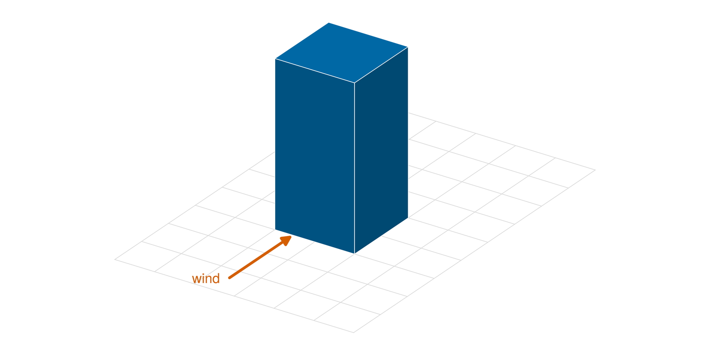</a><!--/fig--><br><b>Case A</b> — 1:1:2 building<br><sub>186 points · U, V, W, k</sub></td>
<td valign="top"><!--fig name="case-b.png" alt="Case B — 1:4:4 slab" width="270" label="0"--><a href="validation/figures/geometry/case-b.png" title="1200 dpi original, 0.8 MB">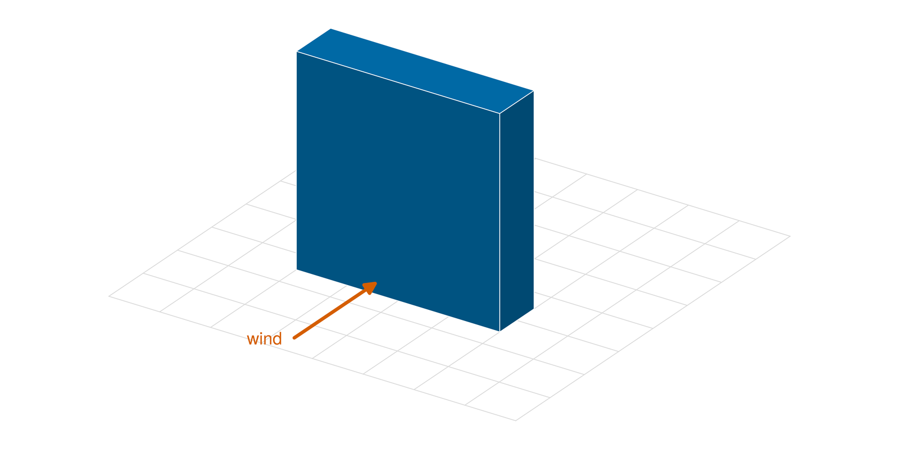</a><!--/fig--><br><b>Case B</b> — 1:4:4 slab<br><sub>224 points · U, V, W, k</sub></td>
<td valign="top"><!--fig name="case-c-2d.png" alt="Case C — 3 × 3 block array" width="270" label="0"--><a href="validation/figures/geometry/case-c-2d.png" title="1200 dpi original, 0.9 MB">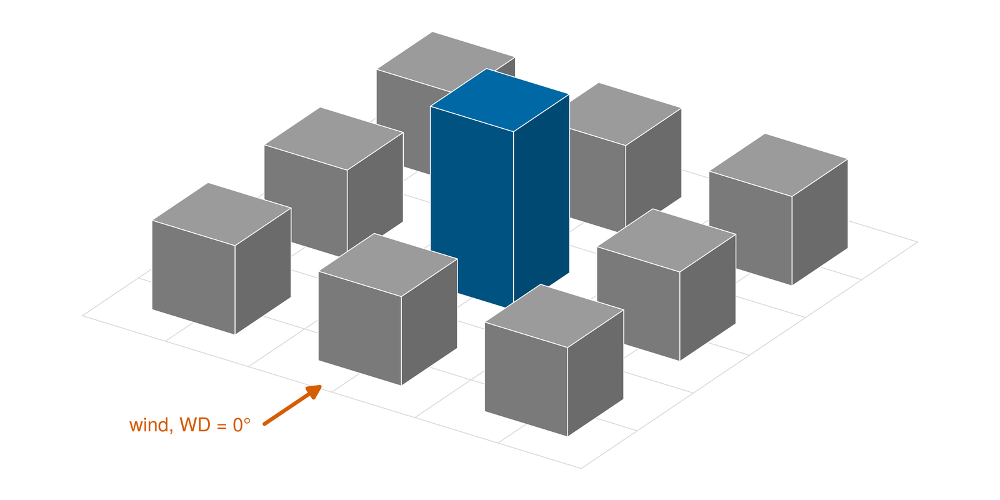</a><!--/fig--><br><b>Case C</b> — 3 × 3 block array<br><sub>1,080 scalar speeds · 9 configurations (2D shown)</sub></td>
</tr>
<tr>
<td valign="top"><!--fig name="case-d.png" alt="Case D — high-rise among city blocks" width="270" label="0"--><a href="validation/figures/geometry/case-d.png" title="1200 dpi original, 2.2 MB">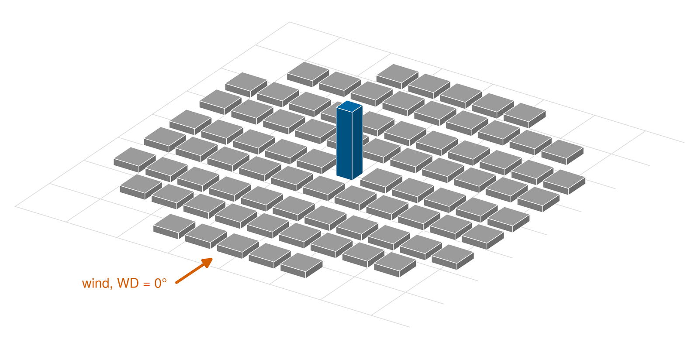</a><!--/fig--><br><b>Case D</b> — high-rise among city blocks<br><sub>78 points × 3 directions · 33 velocity points</sub></td>
<td valign="top"><!--fig name="case-e-after.png" alt="Case E — Niigata district" width="270" label="0"--><a href="validation/figures/geometry/case-e-after.png" title="1200 dpi original, 2.2 MB">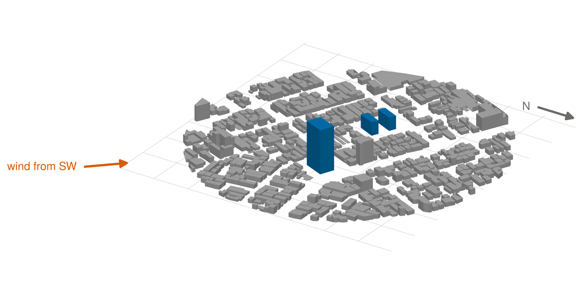</a><!--/fig--><br><b>Case E</b> — Niigata district<br><sub>80 points × 16 directions · before and after (after shown)</sub></td>
<td valign="top"><!--fig name="case-f.png" alt="Case F — Shinjuku district" width="270" label="0"--><a href="validation/figures/geometry/case-f.png" title="1200 dpi original, 1.9 MB">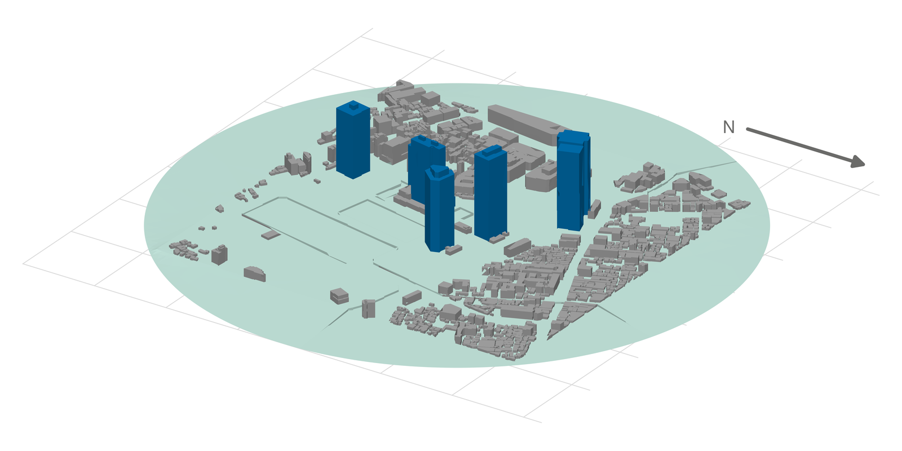</a><!--/fig--><br><b>Case F</b> — Shinjuku district<br><sub>472 velocity ratios · tunnel at three heights and the field</sub></td>
</tr>
<tr>
<td valign="top"><!--fig name="case-g.png" alt="Case G — flow behind a tree belt" width="270" label="0"--><a href="validation/figures/geometry/case-g.png" title="1200 dpi original, 0.7 MB">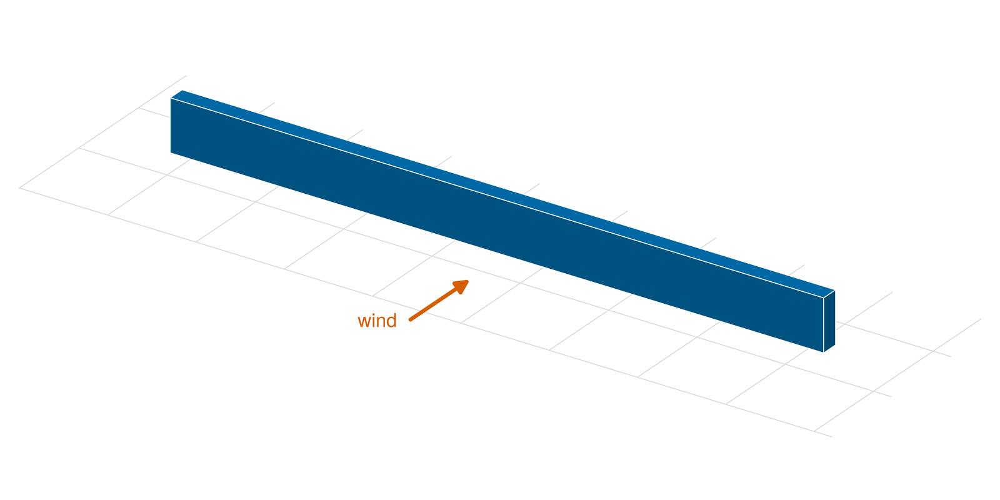</a><!--/fig--><br><b>Case G</b> — flow behind a tree belt<br><sub>28 points · field, U/U_H and k/U_H²</sub></td>
<td valign="top"><!--fig name="case-h.png" alt="Case H — 1:1:2 building, floor source" width="270" label="0"--><a href="validation/figures/geometry/case-h.png" title="1200 dpi original, 0.9 MB">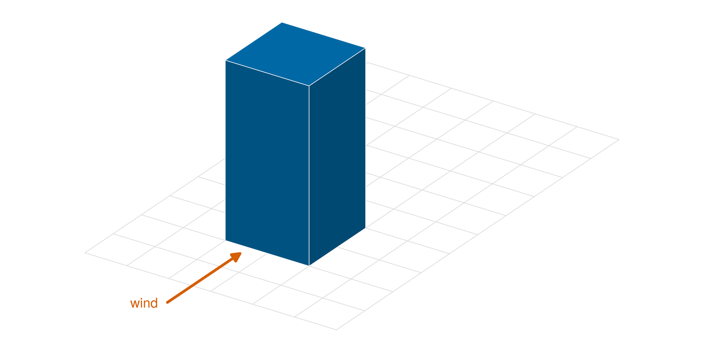</a><!--/fig--><br><b>Case H</b> — 1:1:2 building, floor source<br><sub>1,652 rows · velocity and concentration</sub></td>
<td valign="top"><!--fig name="case-i.png" alt="Case I — cube, roof source" width="270" label="0"--><a href="validation/figures/geometry/case-i.png" title="1200 dpi original, 1.0 MB">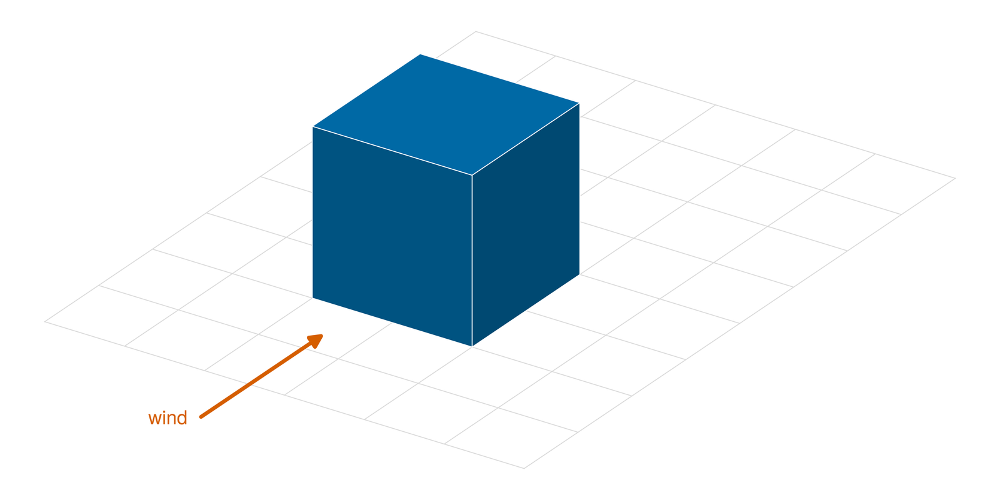</a><!--/fig--><br><b>Case I</b> — cube, roof source<br><sub>630 rows · LDV velocity and concentration</sub></td>
</tr>
<tr>
<td valign="top"><!--fig name="case-j.png" alt="Case J — 1:1:2 building, non-isothermal" width="270" label="0"--><a href="validation/figures/geometry/case-j.png" title="1200 dpi original, 1.4 MB">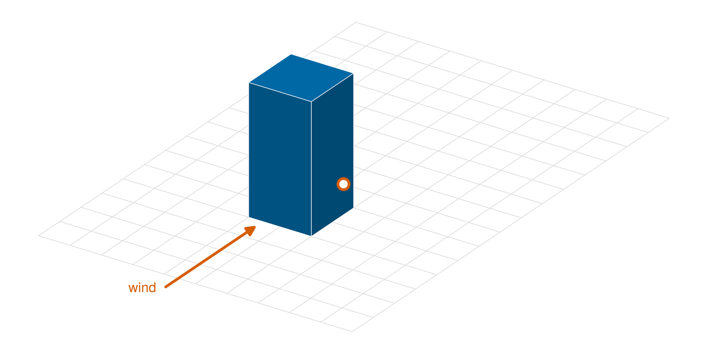</a><!--/fig--><br><b>Case J</b> — 1:1:2 building, non-isothermal<br><sub>444 rows · velocity, temperature, concentration, fluxes</sub></td>
<td valign="top"><!--fig name="case-k.png" alt="Case K — 9 × 9 cube array, point source" width="270" label="0"--><a href="validation/figures/geometry/case-k.png" title="1200 dpi original, 2.0 MB">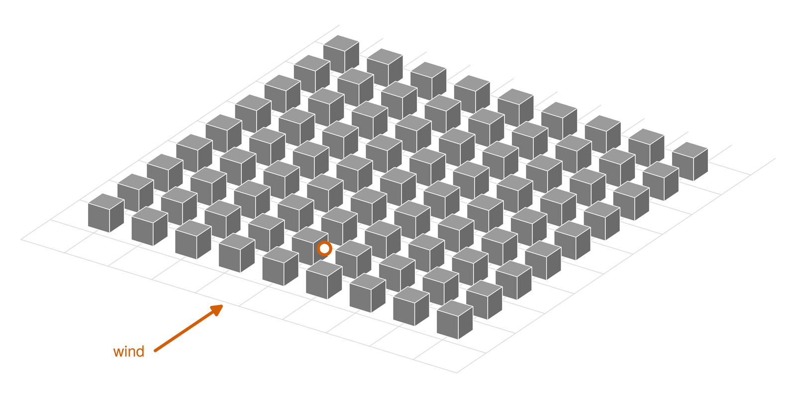</a><!--/fig--><br><b>Case K</b> — 9 × 9 cube array, point source<br><sub>203 rows · velocity and concentration</sub></td>
<td valign="top"><!--fig name="case-l.png" alt="Case L — 9 × 14 cube array, line source, non-isothermal" width="270" label="0"--><a href="validation/figures/geometry/case-l.png" title="1200 dpi original, 2.3 MB">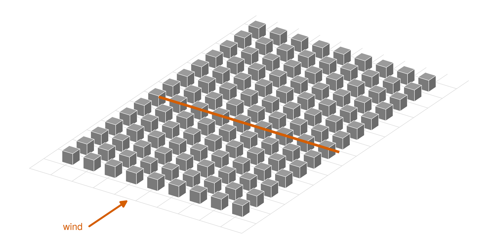</a><!--/fig--><br><b>Case L</b> — 9 × 14 cube array, line source, non-isothermal<br><sub>344 rows · velocity, temperature, concentration, fluxes</sub></td>
</tr>
<tr>
<td valign="top"><!--fig name="case-m.png" alt="Case M — TPU Atsugi campus" width="270" label="0"--><a href="validation/figures/geometry/case-m.png" title="1200 dpi original, 1.8 MB">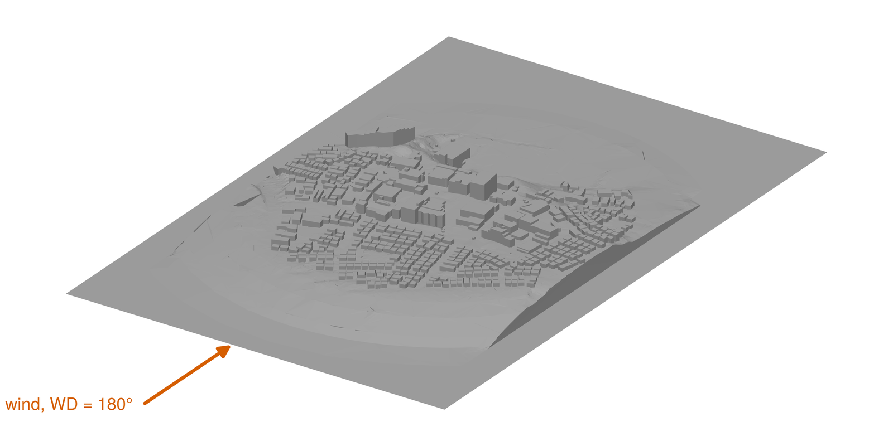</a><!--/fig--><br><b>Case M</b> — TPU Atsugi campus<br><sub>330 rows · tunnel and field concentration</sub></td>
<td></td>
<td></td>
</tr>
</table>

- **Site:** <https://sustainableurbansystems.com/CFD-Test-Cases-Architectural-Institute-of-Japan-AIJ/>
- **API:** [`/api/index.json`](https://sustainableurbansystems.com/CFD-Test-Cases-Architectural-Institute-of-Japan-AIJ/api/index.json) · [`/api/llms.txt`](https://sustainableurbansystems.com/CFD-Test-Cases-Architectural-Institute-of-Japan-AIJ/api/llms.txt) for agents · [OpenAPI](https://sustainableurbansystems.com/CFD-Test-Cases-Architectural-Institute-of-Japan-AIJ/api/openapi.json) (the same files are in [`docs/api/`](docs/api/)); every release is also frozen under `/api/<release>/`, listed in [`/api/versions.json`](https://sustainableurbansystems.com/CFD-Test-Cases-Architectural-Institute-of-Japan-AIJ/api/versions.json)
- **Release:** [v3.0.0](CHANGELOG.md), rebuilt byte for byte from its tag (see *Versions, releases and reproducing them*)

| Case | Configuration | Measurements | Reference file |
|---|---|---|---|
| A | 1:1:2 building, b = 0.08 m, H = 0.16 m, Re_H ≈ 24,000 | 186 points, U/V/W/k | `raw/cases/case-a/RS-caseA.csv` |
| B | 1:4:4 slab, 0.05 × 0.20 × 0.20 m, Re_H ≈ 72,000 | 224 points, U/V/W/k | `raw/cases/case-b/RS_caseB.csv` |
| C | 3 × 3 block array, centre building at 0D / 1D / 2D | 1080 points, pedestrian height | `raw/cases/case-c/RS_caseC.csv` |
| D | High-rise among blocks | see `raw/cases/case-d/` | `raw/cases/case-d/LF_caseD.xls` |
| E | Niigata district, 1:250, pre/post high-rise | pedestrian height | `raw/cases/case-e/LF_caseE.xls` |
| F | Shinjuku sub-centre, Tokyo, 1:800 tunnel and field, November 1978 | 472 velocity ratios at 13 points: tunnel at 5, 9 and 20 m and field cup anemometers | `raw/cases/case-f/RS-WT_caseF.csv` |
| G | Tree belt (Tsuiji-matsu), field observation, 74 m × 2 m × 7 m | 28 points, U/U_H and k/U_H² | `raw/cases/case-g/RS_caseG.csv` |
| H | 1:1:2 building with a floor point source (ethylene) | 876 points, velocity and concentration | `raw/cases/case-h/RS_caseH.csv` |
| I | Cube with a roof point source (ethane) | 91 LDV points and 539 concentration points | `raw/cases/case-i/RS-w_caseI.csv` |
| J | 1:1:2 building with a floor source, non-isothermal | 444 points, velocity, temperature, concentration, fluxes | `raw/cases/case-j/RS_caseJ.csv` |
| K | 9 × 9 cube array, point source | 203 points, velocity and concentration | `raw/cases/case-k/RS_caseK.csv` |
| L | 14 × 9 cube array, line source, non-isothermal | 344 points, velocity, temperature, concentration, fluxes | `raw/cases/case-l/RS_caseL.csv` |
| M | TPU Atsugi campus, 1:600 tunnel and field tracer release | 330 rows: tunnel velocity and concentration, 18 field runs | `raw/cases/case-m/RS-WT_caseM.csv` |

Sources and instrumentation are documented per case in each folder's `readme_case*.md` and in the data paper,
[Kikumoto et al. (2026)](https://doi.org/10.1002/2475-8876.70083) (linked, not stored here); each case's Zenodo
record is linked in its section. [`clean/`](clean/README.md) re-releases all thirteen cases in one schema (SI units,
one frame per case), regenerated from the published files by a checked, deterministic build.

**Validation status.** *Scored* means a run exists and its scores are on this page — not that it agrees; how well
it agrees is in the numbers and their reading. Anything not marked scored is not a claim.

| Case | OpenFOAM 12, realizable k-ε | UMF (non-isothermal cases) | OpenLB | FluidX3D | ML surrogate (Yel-2.0) |
|---|---|---|---|---|---|
| A | scored | — | scored | scored | ✔ |
| B | scored | — | scored | scored | ✔ |
| C | scored, 9 configurations | — | not comparable at dx = 1.6 m | not comparable (no ground wall function) | ✔ |
| D | scored, WD 0°, 22.5° and 45° | — | not comparable at dx = 1.6 m | not comparable (no ground wall function) | ✔ |
| E | scored, SW | — | not comparable at dx = 1.6 m | not comparable (no ground wall function) | ✔ |
| F | scored, wind from NNW in two vertical frames | — | pending | pending | pending |
| G | scored, a drag sweep of four arms and a half belt | — | pending | pending | pending |
| H | scored | — | pending | pending | pending |
| I | scored, also standard k-ε and k-ω SST | — | pending | pending | pending |
| J | pending | scored, realizable k-ε and buoyantKEpsilon | pending | pending | pending |
| K | scored | — | pending | pending | pending |
| L | pending | scored | pending | pending | pending |
| M | scored, WD 180, three Schmidt numbers | — | pending | pending | pending |

*Pending* means not run yet. *—* means the engine does not apply: UMF (urbanMicroclimateFoam, an OpenFOAM 12
solver) is Eddy3D's engine for the non-isothermal Cases J and L, where the isothermal OpenFOAM 12 engine was not run.

---

<details>
<summary><b>Case A — 1:1:2 building</b> · 186 points, U/V/W/k · scored: OpenFOAM 12, OpenLB, FluidX3D, ML</summary>

<p><!--fig name="case-a.png" alt="Case A geometry" width="700"--><a href="validation/figures/geometry/case-a.png"></a><br><sub><a href="validation/figures/geometry/case-a.png">1200 dpi original, 0.8 MB</a></sub><!--/fig--><br>
<em>Isolated 1:1:2 building, b = 0.08 m, H = 0.16 m (model scale); the wind blows along +x.</em></p>

**Configuration.** A 1:1:2 (width : depth : height) prism, b = 0.08 m, H = 2b = 0.16 m, centred on the origin.
Re_H ≈ 24,000 on H and the approach wind speed at H, U_H = 4.491 m/s. Hot-wire split-fibre probes
(DANTEC 55R55 streamwise, 55R57 spanwise/vertical), 1000 Hz for 60 s per point, 500 Hz low-pass. Tunnel:
Technical Research Institute, Shimizu Corporation, Tokyo. Data collectors: Takeshi Ishihara (University of
Tokyo) and Kazuki Hibi (Numerical Flow Design); DOI
[10.5281/zenodo.15050147](https://doi.org/10.5281/zenodo.15050147).

**Reference data.** `case-a/RS-caseA.csv` — `No., x(m), y(m), z(m), U, V, W, u_rms, v_rms, w_rms, k`;
186 points on the vertical centre plane y/b = 0 and the horizontal planes z/b = 0.125 and 1.25. Coordinates are
**metres**, velocities m/s, turbulence as **rms** values. Approach flow in `AF_caseA.csv` (24 heights,
z = 0.005 … 0.6 m, with u/v/w rms and k). Point layouts: `MP-y_caseA.png`, `MP-z_caseA.png`. Frame: +x
streamwise, +y lateral (V positive toward +y), +z up; building spans x, y ∈ [−0.04, 0.04], z ∈ [0, 0.16];
points published on the y ≤ 0 half.

**Inflow fit** (log law over z = 0.02 … 2H): u\* = 0.343 m/s, z₀ = 0.668 mm, U_H measured 4.491 m/s, log-law
error +2.0 %.

**Validation (OpenFOAM 12, realizable k-ε).** Normalised by U_H; hit rate D = 0.25, W = 0.05 U_H.
Reattachment length **L_r/H = 1.49**.

| | U | V | W | k |
|---|---|---|---|---|
| **R** | +0.955 | +0.961 | +0.708 | +0.480 |
| **FAC2** | 0.817 | 0.349 | 0.398 | 0.667 |
| **FB** | +0.185 | −0.207 | −1.501 | +0.478 |
| **hit rate** | 0.586 | 0.892 | 0.801 | 0.177 |

The streamwise field is right (R ≈ 0.96, FAC2 0.82); k is under-predicted (FB +0.48, R 0.48); FAC2 on V and
W is low by construction because those components change sign; the W FB of −1.50 is an artefact of a near-zero
mean (mean measured W is ~0.01 m/s) — read R = +0.71 instead. Figures and the full reading are under
*Validation method* below.

**ML surrogate (Yel-2.0)** on the 65 points of the z = 0.01 m plane, scaled ×180 so the plane sits at its 1.8 m
prediction height: |U|/U_H FB +0.77, FAC2 0.26, R −0.13, hit rate 0.09 — and its prediction does not change
when the wind is reversed. See *ML surrogate* under *Validation method*.

**OpenLB** at dx = 1.6 m (H/10): U/U_H R +0.76, FAC2 0.43 over all 186 points, FAC2 0.65 over the 121 at least two
cells above its no-slip floor; a nearly steady solve with a 3.39 H wake. See *every engine on the same points*.

**FluidX3D** at dx = H/64: U/U_H R +0.84, FAC2 0.60 on the 116 points where its empty-domain control holds the
log law; there, the approach flow alone scores better on every U statistic except the correlation.

**API.** [`cases/A.json`](docs/api/cases/A.json) · [`points.json`](docs/api/cases/A/points.json) /
[`points.csv`](docs/api/cases/A/points.csv) (variances uu = u_rms² so A and B share one column meaning) ·
[`geometry.stl`](docs/api/cases/A/geometry.stl) (1 box, 12 triangles) · [`validation.json`](docs/api/cases/A/validation.json)

</details>

<details>
<summary><b>Case B — 1:4:4 slab</b> · 224 points, U/V/W/k · scored: OpenFOAM 12, OpenLB, FluidX3D, ML</summary>

<p><!--fig name="case-b.png" alt="Case B geometry" width="700"--><a href="validation/figures/geometry/case-b.png"></a><br><sub><a href="validation/figures/geometry/case-b.png">1200 dpi original, 0.8 MB</a></sub><!--/fig--><br>
<em>Isolated 1:4:4 slab, 0.05 m along the wind, 0.20 m across, 0.20 m tall (model scale); the wind blows along +x.</em></p>

**Configuration.** A 1:4:4 (depth : width : height) slab, 0.05 m deep (along the wind) × 0.20 m wide × 0.20 m
high, centred on the origin. Re_H ≈ 72,000 on H and U_H = 5.133 m/s. Hot-wire split-fibre probe, 100 Hz, 60 s per
point. Tunnel: Niigata Institute of Technology, Kashiwazaki. Data collector: Yoshihide Tominaga; DOI
[10.5281/zenodo.15401455](https://doi.org/10.5281/zenodo.15401455).

**Reference data.** `case-b/RS_caseB.csv` — `No., x[mm], y[mm], z[mm], U, V, W, <u'2>, <v'2>, <w'2>, k`;
224 points on the vertical centre plane y/H = 0 and the horizontal plane z/H = 1/16. Coordinates are
**millimetres**, velocities m/s, turbulence as **variances**. Approach flow in `AF_caseB.csv` (12 heights,
z = 0.005 … 1.0 m, with a 1/4-power fit column). Point layouts: `MP-y_caseB.png`, `MP-z_caseB.png`. Frame: +x
streamwise, +z up; slab spans x ∈ [−0.025, 0.025], y ∈ [−0.10, 0.10], z ∈ [0, 0.20]; points on the y ≤ 0 half.
**The published V is positive toward −y** (see *Known data issues*); the API flips it so that A and B agree.

**Inflow fit** (log law over z = 0.02 … 2H): u\* = 0.399 m/s, z₀ = 0.882 mm, U_H measured 5.133 m/s, log-law
error +2.9 %.

**Validation (OpenFOAM 12, realizable k-ε).** Normalised by U_H; hit rate D = 0.25, W = 0.05 U_H.
Reattachment length **L_r/H = 3.27**.

| | U | V | W | k |
|---|---|---|---|---|
| **R** | +0.959 | +0.910 | +0.929 | +0.399 |
| **FAC2** | 0.701 | 0.281 | 0.536 | 0.562 |
| **FB** | +0.240 | +0.370 | +0.263 | +0.463 |
| **hit rate** | 0.562 | 0.612 | 0.808 | 0.223 |

The streamwise field is right (R ≈ 0.96, FAC2 0.70); k is under-predicted (FB +0.46, R 0.40). The flat row of
model V ≈ 0 in the agreement panel is the symmetry plane: a RANS solution is symmetric, so V ≡ 0 at y = 0, while
the tunnel measures small non-zero values.

**ML surrogate (Yel-2.0)** on the 122 points of the z = H/16 plane, scaled ×144: |U|/U_H FB +0.82, FAC2 0.36,
R −0.24, hit rate 0.17. See *ML surrogate* under *Validation method*.

**OpenLB** at dx = 1.6 m (H/12.5): U/U_H R +0.79, FAC2 0.38 over all 224 points, FAC2 0.64 and R +0.90 over the 95
at least two cells above its floor; its wake sits about H/2 downstream of the tunnel's.

**FluidX3D** at dx = H/64: U/U_H R +0.95, FAC2 0.64 on the 88 points where its empty-domain control holds the
log law, beating its approach flow on every U statistic.

**API.** [`cases/B.json`](docs/api/cases/B.json) · [`points.json`](docs/api/cases/B/points.json) /
[`points.csv`](docs/api/cases/B/points.csv) (metres, V sign unified) · [`geometry.stl`](docs/api/cases/B/geometry.stl)
(1 box) · [`validation.json`](docs/api/cases/B/validation.json)

</details>

<details>
<summary><b>Case C — 3 × 3 block array</b> · 1080 points, scalar speed at pedestrian height, 9 configurations · scored: OpenFOAM 12, ML</summary>

<table>
<tr>
<td valign="top"><!--fig name="case-c-0d.png" alt="Case C, 0D" width="270" label="0"--><a href="validation/figures/geometry/case-c-0d.png" title="1200 dpi original, 0.9 MB">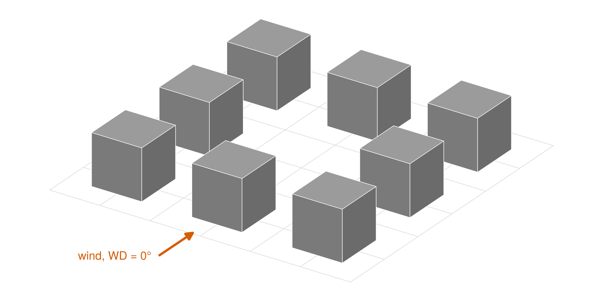</a><!--/fig--><br><sub>0D: the centre block removed.</sub></td>
<td valign="top"><!--fig name="case-c-1d.png" alt="Case C, 1D" width="270" label="0"--><a href="validation/figures/geometry/case-c-1d.png" title="1200 dpi original, 0.9 MB">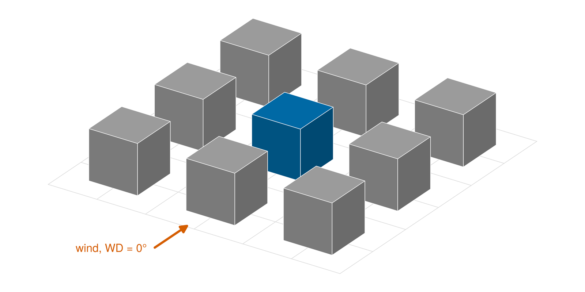</a><!--/fig--><br><sub>1D: the centre block as tall as its neighbours, D = 0.20 m.</sub></td>
<td valign="top"><!--fig name="case-c-2d.png" alt="Case C, 2D" width="270" label="0"--><a href="validation/figures/geometry/case-c-2d.png" title="1200 dpi original, 0.9 MB"></a><!--/fig--><br><sub>2D: the centre block twice as tall, 2D = 0.40 m.</sub></td>
</tr>
</table>

<em>The three configurations of the centre block, on one scale; 120 measurement points each, at three wind directions.</em>

**Configuration.** Nine cubes of side D = 0.20 m on a 0.40 m pitch (street width = D), array footprint
1.0 × 1.0 m, centred on the origin. The centre building is tested at three heights — 0D (absent), 1D (0.2 m, as
the surroundings) and 2D (0.4 m) — and at three wind directions, 0°, 22.5° and 45°: **nine configurations**, all
sharing one 120-point set. Scalar wind speed Vs by thermistor anemometer (1 Hz, 30 s) at z = 0.02 m = 0.1 D
(2.0 m at the 1:100 scale Eddy3D would solve it at); approach flow by I-type hot wire (500 Hz, 30 s).
Re ≈ 52,000 on D; U_H = U(z = D) = 3.654 m/s. Tunnel: Fujita Corporation, Tokyo. Data collector: Yoshitami
Nonomura (Yamato University); DOI [10.5281/zenodo.15401791](https://doi.org/10.5281/zenodo.15401791).
The 0.40 m pitch is read from `MP-z-caseC.png` and Figure 3 of the data paper; the 120-point grid alone (49 absent
nodes of a 13 × 13 lattice = the nine footprints) bounds the pitch to (0.35, 0.40].

**Reference data.** `case-c/RS_caseC.csv` — `No., WD (deg.), CB, x (m), y (m), z (m), Vs (m/s),` (note
the trailing comma: an empty 8th column). 1080 rows = 3 WD × 3 CB × 120 points; coordinates **metres** (range
±0.30), z = 0.02 throughout; `CB` is **text** (`0D`/`1D`/`2D`). Point numbers run 4 … 132 with gaps at 34–37, 46,
55, 100–102 (1, 2, 3 are below the range). Approach flow in `AF_caseC.csv` (16 heights, z = 0.01 … 1.2 m, U and
u_rms). Frame: +x streamwise at WD = 0, confirmed three ways on the data (y → −y is a symmetry; the x ≤ −0.25 band
is faster than x ≥ +0.25 in every configuration; the regression slope of Vs is most negative within 0.8–4.3° of
+x). In the CSV's own frame WD rotates the wind from +x toward **−y** (the WD = 45° field mirrors about y = −x at
0.10–0.13 m/s, the experiment's repeatability, and not about y = +x, 0.5–0.8 m/s); Figure 3 of the data paper
draws the fan the other way — a y-sign flip that is invisible at WD = 0. This release keeps the CSV frame.

**Inflow fit** (log law, κ = 0.41, on `AF_caseC.csv`): over z = 0.02 … 0.40 m, u\* = 0.25598 m/s,
z₀ = 0.4797 mm (U_D +3.08 %, but U(0.02) −4.31 %, so the scored ratio is biased −7.17 %); over z = 0.01 … 0.40 m,
u\* = 0.22853 m/s, z₀ = 0.2362 mm (+1.65 % at 0.02 m, +2.83 % at D, ratio bias −1.15 %). The profile's fitted
power-law exponent is 0.190 over that range (the paper's 0.28 is for the full boundary layer); turbulence
intensity at z = D is 0.219.

**What a validation will have to handle.** Vs is an omnidirectional *scalar* speed — no Vs in the 1080 rows is
below 0.13 U_H, a floor a RANS |U| goes well under in a sheltered street — so the comparison is the bracket
|U| ≤ Vs ≤ √(|U|² + 2k), not one number. 24 of the 120 points sit exactly on a building face plane (|x| or
|y| = 0.30) in the gap between blocks. The structure to reproduce at WD = 0: the 2D centre block roughly doubles
the windward street's pedestrian speed over 0D (mean Vs 2.398 vs 1.172 m/s) while the leeward street moves little
(1.315 vs 1.090). Repeatability floor from the mirror pairs: mean |ΔVs| 0.088–0.137 m/s (0.024–0.038 U_H).

**Validation (OpenFOAM 12, realizable k-ε).** All nine configurations, solved at 1:100 on a cylindrical domain
(the tunnel's turntable: the array turns with WD, the domain does not), ~310,000 cells per centre-block height,
3000 iterations per direction, the 120 probes at exactly the tunnel's coordinates. Scored against Vs/U_H as
√(|U|² + 2k) (headline) and as |U|; hit rate D = 0.25, W = 0.05 U_H.

<!--fig name="case-c-openfoam-agreement.png" alt="Case C, measured vs modelled, nine configurations" width="800"--><a href="validation/figures/case-c-openfoam-agreement.png">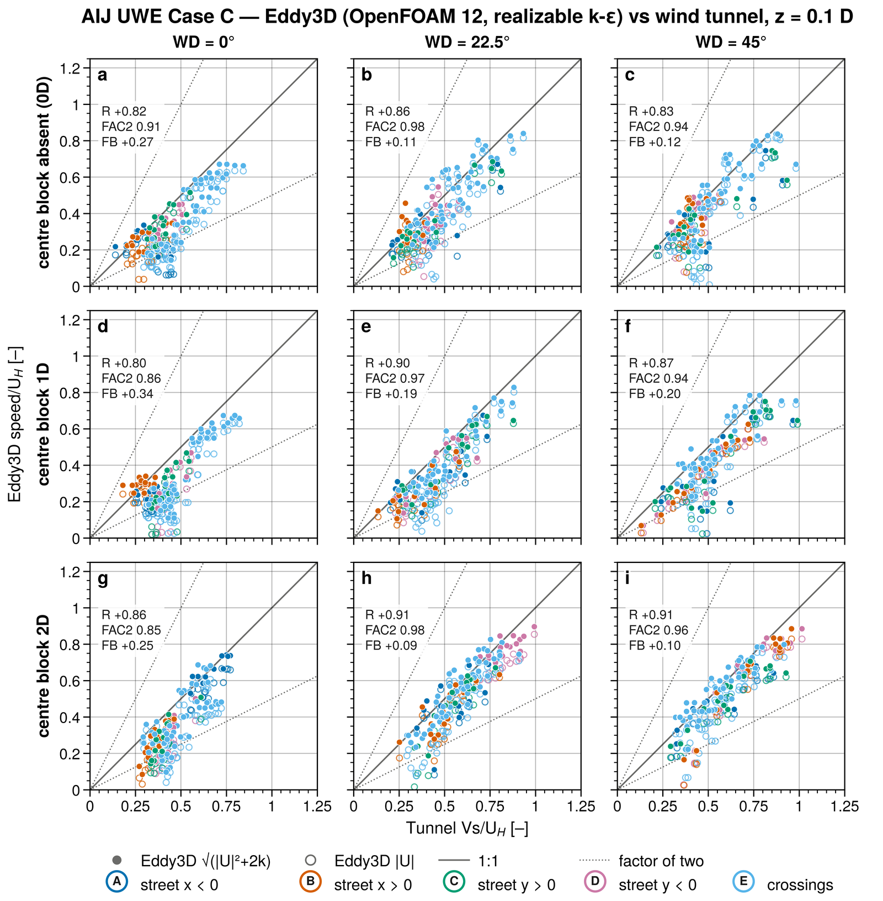</a><br><sub><a href="validation/figures/case-c-openfoam-agreement.png">1200 dpi original, 5.6 MB</a></sub><!--/fig-->

| centre block | WD | R | FAC2 | FB | hit rate | \|U\| alone: FB / R |
|---|---|---|---|---|---|---|
| 0D | 0° | +0.824 | 0.908 | +0.266 | 0.567 | +0.466 / +0.804 |
| 0D | 22.5° | +0.857 | 0.983 | +0.106 | 0.750 | +0.295 / +0.846 |
| 0D | 45° | +0.831 | 0.942 | +0.121 | 0.783 | +0.307 / +0.801 |
| 1D | 0° | +0.801 | 0.858 | +0.341 | 0.433 | +0.551 / +0.741 |
| 1D | 22.5° | +0.896 | 0.975 | +0.192 | 0.675 | +0.394 / +0.882 |
| 1D | 45° | +0.872 | 0.942 | +0.198 | 0.733 | +0.353 / +0.873 |
| 2D | 0° | +0.857 | 0.850 | +0.251 | 0.492 | +0.443 / +0.848 |
| 2D | 22.5° | +0.906 | 0.983 | +0.091 | 0.875 | +0.240 / +0.894 |
| 2D | 45° | +0.909 | 0.958 | +0.103 | 0.883 | +0.243 / +0.912 |

<!--fig name="case-c-openfoam-bias-map.png" alt="Case C, where the model is slow or fast" width="800"--><a href="validation/figures/case-c-openfoam-bias-map.png">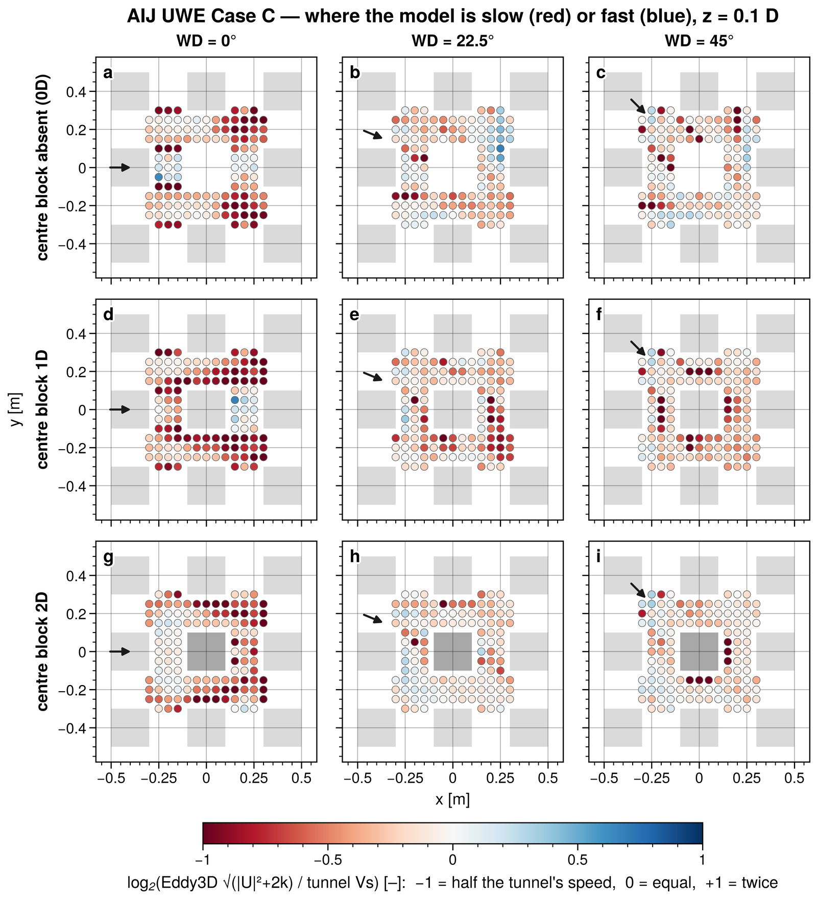</a><br><sub><a href="validation/figures/case-c-openfoam-bias-map.png">1200 dpi original, 4.0 MB</a></sub><!--/fig-->

Reading these:

- **The pattern is right in every configuration** — R 0.80–0.91, FAC2 0.85–0.98.
- **The model is slow, worst at WD = 0** (FB +0.25 … +0.34, hit rate 0.43–0.57; at 22.5° and 45° FB +0.09 … +0.20,
  hit rate 0.68–0.88). The map puts the deficit in the streets running along the wind.
- **It is not the scalar-vs-vector question.** The tunnel reads above even √(|U|² + 2k) at 902 of the 1080
  points (84 %); |U| alone is lower still.
- **Where the deficit comes from is not settled.** An earlier version of this page put it on the inflow, reading the
  approach flow at the probe height as 0.83 of the tunnel's. That reading was a sampling artefact: upstream of the
  array the probe height lies below the centre of the first cell of the coarse background mesh, where the probes'
  cell-to-point interpolation runs linearly to zero at the wall (the sampled |U| is exactly proportional to z there:
  1.00 m/s at 1 m, 2.01 m/s at 2 m). At z = D the approach matches the tunnel (0.99). At the measurement points the
  sampling is sound: none of the 240 checked (2D at 0°, 0D at 45°) has its 2 m sample inside the first cell.
- **The frame is checked by the scores, not assumed.** Scored with the paper figure's rotation sense (the y
  mirror) R falls to −0.33 … +0.03 at 22.5° and 45°; with upwind and downwind swapped (the x mirror) to
  −0.41 … +0.14 in eight of nine configurations (+0.56 for 2D at 22.5°). The CSV's own sense — WD turns the wind
  from +x toward −y — is the one the measurement was taken in.
- Every score is reproduced by an independent re-scoring from the probe files and the original
  `RS_caseC.csv` (largest difference 9 × 10⁻¹⁶); the per-point pairs are in
  [`validation/results/caseC_openfoam12_realizableKE_pairs.csv`](validation/results/caseC_openfoam12_realizableKE_pairs.csv).

**ML surrogate (Yel-2.0)**, scaled ×90 so z = 0.1 D sits at its 1.8 m prediction height, all nine configurations:
FB +0.67, FAC2 0.44, R +0.21, hit rate 0.18 — see *ML surrogate* under *Validation method*.

**API.** [`cases/C.json`](docs/api/cases/C.json) · [`points.json`](docs/api/cases/C/points.json) /
[`points.csv`](docs/api/cases/C/points.csv) · [`geometry.json`](docs/api/cases/C/geometry.json) (box lists) ·
[`geometry.stl`](docs/api/cases/C/geometry.stl) (2D) / [`geometry_1D.stl`](docs/api/cases/C/geometry_1D.stl) /
[`geometry_0D.stl`](docs/api/cases/C/geometry_0D.stl) · [`validation.json`](docs/api/cases/C/validation.json)

</details>

<details>
<summary><b>Case D — high-rise among city blocks</b> · 78 points × 3 directions (thermistor) + 33 points U/V/W/k · scored: OpenFOAM 12 (WD 0°, 22.5° and 45°), ML</summary>

<p><!--fig name="case-d.png" alt="Case D geometry" width="700"--><a href="validation/figures/geometry/case-d.png"></a><br><sub><a href="validation/figures/geometry/case-d.png">1200 dpi original, 2.2 MB</a></sub><!--/fig--><br>
<em>A 0.25 m tower (blue) among 82 low blocks over 1.40 m × 1.35 m (1:400 model scale); the arrow is WD = 0°.</em></p>

**Configuration.** One 1:1:4 tower, 0.25H × 0.25H × H = 62.5 × 62.5 × 250 mm, replacing the centre block of a
regular array of 82 blocks of 0.4H × 0.4H × 0.1H = 100 × 100 × 25 mm; roads 0.1H / 0.2H / 0.3H = 25 / 50 / 75 mm
(9 columns in x on an alternating 175 / 150 mm pitch, 11 rows in y on 125 mm); the array is 1400 × 1350 mm with
its corners cut by the turntable circle. Scale 1:400 (H = 100 m full scale); U_H = 6.65 m/s at H = 250 mm;
Re ≈ 1.1 × 10⁵. All measurements at z = 5 mm (2 m full scale): a thermistor anemometer at 78 points for WD = 0,
22.5 and 45° (66 measured per direction — the 12 points in the band around the tower are unmeasured) and a
split-fibre probe at 33 points for WD = 0 with U, V, W, variances and k. Source: Kikumoto et al. (2026) §3.4;
data collector Yoshihide Tominaga; DOI [10.5281/zenodo.15402668](https://doi.org/10.5281/zenodo.15402668) (named
in the data paper). This folder ships without the record's readme and CSVs; they are mirrored byte for byte, with
their SHA-256 sums, under [`clean/sources/zenodo_caseD/`](clean/sources/zenodo_caseD/), and the CSVs match the
workbook to 4 × 10⁻¹⁶.

**Reference data.** Everything is inside `case-d/LF_caseD.xls`, a genuine OLE2/BIFF8
workbook (xlrd 2.x reads it; openpyxl cannot): sheets `Geometry&Points`, `Inflow` (13 heights, z = 5 … 1200 mm,
U and k), `Results (Exp_S)` (split fibre) and `Results (Exp_T)` (thermistor; unmeasured cells are `-`).
Coordinates are **millimetres**; the API serves metres. Frame: +x streamwise at WD = 0 (the 0° thermistor field
is exactly y-mirror symmetric — 33 exact pairs, so only 33 of the 66 values are independent; the split-fibre U is
positive at the stream-like points and negative in the tower's windward horseshoe). The rotation sense for 22.5°
and 45° is **+x toward +y, read from Figure 4 of the data paper** — the array is exactly y-mirror symmetric, so
the data cannot settle it. `BD_caseD.stl` is the geometry: 83 closed shells in model metres, but **dirty** (1572
facets, 576 duplicates, all 83 roofs wound inward, signed volume 0.011159 m³ against the true 0.021477 m³); the
API's `geometry.stl` is rebuilt from the shells' boxes (996 facets, watertight, 0.021477 m³). The DXF adds nothing
over the STL. `case-d-eddy3d-prior-comparison.xlsx` is a prior attempt that scores R = +0.096 against the thermistor — a frame or
geometry error, not a validation.

**Inflow fit** (log law, κ = 0.41, two windows because the measurement plane z/H = 0.02 sits below the A/B
window): over z = 0.005 … 2H, u\* = 0.3418 m/s, z₀ = 0.0859 mm (U at 5 mm −11.2 %, profile rms 7.9 %, inlet
k 0.3895 m²/s², 26–48 % below the tunnel's); over z = 0.02 … 2H, u\* = 0.4240 m/s, z₀ = 0.4033 mm (U at 5 mm
−30.0 %, inlet k 0.5991). Fitted power-law exponent 0.189 (the paper states 0.25). A log-law inlet cannot be
right at both the measurement plane and the upper profile.

**What a validation will have to handle.** Case D is the only case where both instruments overlap: over the 33
shared points the thermistor reads 1.342× |U| (ratio of means; 1.50 as the mean of ratios), and
√(|U|² + 2k) from the split-fibre data matches the thermistor to FB +0.058, R 0.947, FAC2 1.000 where |U| alone
gives FB +0.292, R 0.872. That correction is 40 % of the scored quantity's square, fed by an inlet whose k is
half the tunnel's — so a low bias should be expected and attributed, not treated as a surprise.

**Sensors against the geometry.** Every one of the 78 points lies outside every block of the cleaned STL and inside
the array; shifting the cloud by 12.5 mm (5 m full scale) puts points 27 and 28 inside the tower, so the check
resolves an offset well below one road width. On this evidence the workbook's sensor coordinates and the geometry
agree.

**Validation (OpenFOAM 12, realizable k-ε), all three wind directions: 0°, 22.5° and 45°**; each about 15 h on
8 cores beside a production campaign. 3.6 million cells at 1:400 on a cylinder domain,
3000 iterations; the last iteration's initial residuals are below 4 × 10⁻³.

<!--fig name="case-d-openfoam-agreement.png" alt="Case D, measured vs modelled" width="800"--><a href="validation/figures/case-d-openfoam-agreement.png">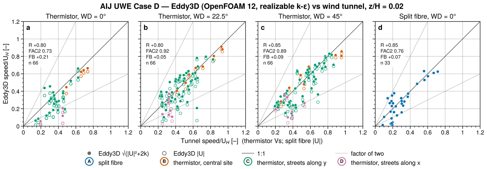</a><br><sub><a href="validation/figures/case-d-openfoam-agreement.png">1200 dpi original, 2.6 MB</a></sub><!--/fig-->

| | n | FAC2 | FB | q | R |
|---|---|---|---|---|---|
| WD 0° · thermistor Vs · √(\|U\|²+2k) | 66 | 0.73 | +0.21 | 0.48 | 0.80 |
| WD 0° · thermistor Vs · \|U\| | 66 | 0.67 | +0.36 | 0.39 | 0.81 |
| WD 22.5° · thermistor Vs · √(\|U\|²+2k) | 66 | 0.92 | +0.05 | 0.67 | 0.80 |
| WD 22.5° · thermistor Vs · \|U\| | 66 | 0.82 | +0.15 | 0.64 | 0.78 |
| WD 22.5° · the same, rotation sense mirrored (control) | 66 | 0.74 | +0.05 | 0.36 | 0.40 |
| WD 45° · thermistor Vs · √(\|U\|²+2k) | 66 | 0.89 | +0.09 | 0.71 | 0.85 |
| WD 45° · thermistor Vs · \|U\| | 66 | 0.82 | +0.17 | 0.70 | 0.84 |
| WD 45° · the same, rotation sense mirrored (control) | 66 | 0.70 | +0.09 | 0.24 | 0.17 |
| WD 0° · split fibre \|U\| · \|U\| | 33 | 0.76 | +0.07 | 0.52 | 0.85 |
| WD 0° · split fibre U · U | 33 | 0.48 | +0.67 | 0.52 | 0.95 |

- **The pattern is right**: R 0.80–0.85 on the thermistor plane at all three headings and 0.85 on the split-fibre |U|. The frame check the
  fixture asserts (R > 0.5 at 0°; a prior Eddy3D attempt at this case scored R 0.10) passes with room to spare.
- **Against the instrument that measures what RANS computes, the model is nearly unbiased.** On the 33 split-fibre
  points its |U| has FB +0.07; against the thermistor it is +0.21 with √(|U|²+2k) and +0.36 with |U|. In the
  tunnel itself the thermistor reads 1.34 times the split-fibre |U| over the same 33 points, so most of the
  thermistor gap is the instrument, not the flow.
- **Its streamwise component is low** (U FB +0.67, R 0.95) while its |U| is not: more of the model's
  near-ground speed is in the lateral and vertical components than the tunnel's.
- **At 22.5° and 45° the solved fields corroborate the rotation sense the data cannot decide.** The array is
  symmetric about y = 0, so a wind turned toward +y and one turned toward −y give mirror-image fields, and the
  measurements alone cannot say which was used; the data paper's Figure 4 draws +y. Scored on the same solutions,
  Figure 4's sense gives R 0.80 and FAC2 0.92 at 22.5°, R 0.85 and FAC2 0.89 at 45°; the mirror gives R 0.40 and
  0.17. At both headings the model is also nearly unbiased against the thermistor (FB +0.05 and +0.09 with
  √(|U|²+2k)).
- **At 0° the 66 thermistor values are 33 mirror pairs**, so only 33 are independent and the mirror control is
  trivially equal there.
- The numbers were reproduced from the solver's probe output against the cleaned table, with the frame mapped
  independently and separate metric code.

The ML surrogate
(Yel-2.0, scaled ×360 so z = 5 mm sits at 1.8 m) scores FB +0.67, FAC2 0.34, R +0.33, hit rate 0.17 on the
thermistor plane (198 points, 3 directions) and FB +0.23, FAC2 0.52, R +0.59 on the 33 split-fibre |U| — the
quantity it predicts. See *ML surrogate* under *Validation method*.

**API.** [`cases/D.json`](docs/api/cases/D.json) · [`points.json`](docs/api/cases/D/points.json) /
[`points.csv`](docs/api/cases/D/points.csv) (267 rows: 234 thermistor + 33 split fibre, `instrument` column) ·
[`geometry.json`](docs/api/cases/D/geometry.json) (83 boxes) · [`geometry.stl`](docs/api/cases/D/geometry.stl) ·
[`validation.json`](docs/api/cases/D/validation.json)


</details>

<details>
<summary><b>Case E — Niigata district</b> · 80 points × 16 directions × before/after, velocity ratio · scored: OpenFOAM 12 (SW), ML</summary>

<table>
<tr>
<td valign="top"><!--fig name="case-e-before.png" alt="Case E, bc" width="410" label="0"--><a href="validation/figures/geometry/case-e-before.png" title="1200 dpi original, 2.3 MB">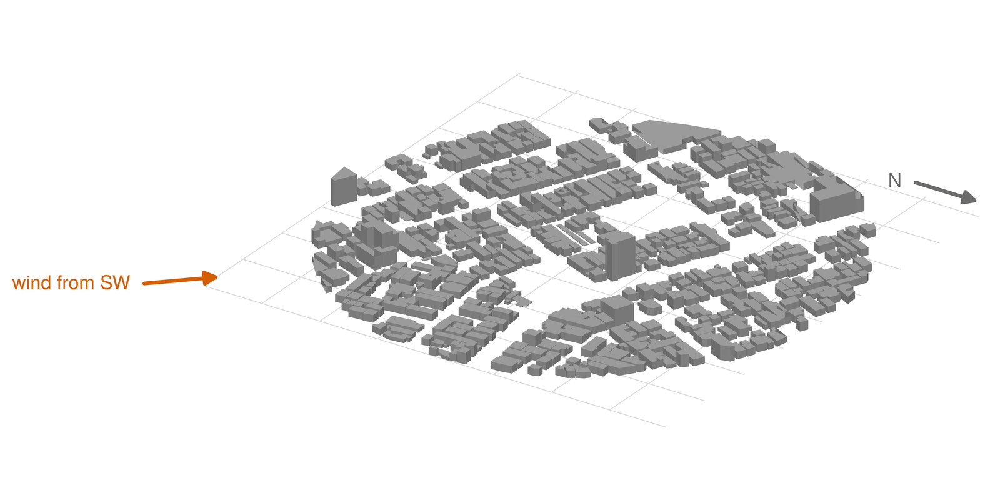</a><!--/fig--><br><sub>Before construction: the existing district, about 400 m across (full scale).</sub></td>
<td valign="top"><!--fig name="case-e-after.png" alt="Case E, ac" width="410" label="0"--><a href="validation/figures/geometry/case-e-after.png" title="1200 dpi original, 2.2 MB"></a><!--/fig--><br><sub>After construction: the 60 m high-rise and the two 18 m mid-rises (blue) added.</sub></td>
</tr>
</table>

<em>The two states, on one scale (full-scale metres, +x east, +y north); the arrow marks SW, the direction Eddy3D is scored at.</em>

**Configuration.** A real district in Niigata City near the Shinano River — dense low-rise stock (median top 6 m,
max 30 m) — at 1:250, measured before and after the construction of a 60 m high-rise (A) and two 18 m mid-rises
(B, C). Thermistor anemometer (100 Hz, 60 s per point, mean scalar speed) at 80 points at z = 2 m full scale
(0.008 m model) for 16 wind directions: 80 × 16 × 2 = 2560 values. Re ≈ 17,000. The measured quantity is a
**velocity ratio**: scalar speed at 2 m / inflow velocity at 15.9 m, the Niigata meteorological station height.
Tunnel: Niigata Institute of Technology; data collector: Yoshihide Tominaga; DOI
[10.5281/zenodo.15429017](https://doi.org/10.5281/zenodo.15429017).

**Reference data.** The readme describes `AF_caseE.csv`, `RS_caseE.csv` and `BD_caseE.stl`, but this folder
holds only `case-e.3dm`, `case-e.ghx`, `LF_caseE.xls`, `MP_caseE.png` and a prior
`case-e-eddy3d-prior-comparison.xlsx`; the Zenodo record's files are mirrored byte for byte under
[`clean/sources/zenodo_caseE/`](clean/sources/zenodo_caseE/). The workbook is cell-identical to Zenodo's, and
Zenodo's `RS_caseE.csv` is the workbook rounded to two decimals, so the cleaned release uses the workbook. The
official `BD_caseE.stl` is at model scale (×250), not watertight (5,253 open edges), and point 50 at
(−45.5, −45.0) lies 0.17 m inside one of its walls (2.06 m clear in the 3dm); the release flags it and solves on
the 3dm-derived geometry. The workbook holds everything: `Geometry&Points` (80 points, "m in actual scale, origin at
the centre of the reproducing area"), `Inflow` (z/ZR, U/UR, k/UR² with ZR = 1 m model = 250 m, UR = 7.8 m/s, and
ε = Cμ^0.5 k dU/dz, Cμ = 0.09) and `Results (Before/After Construction)` (80 × 16 each, columns N … NNW).
The 3dm is **full-scale metres** (`MP_caseE.png` is drawn at model scale, ±0.8 m): layer `buildings` holds the
existing stock (5,015 meshes, the three sites already cleared), `buildings_new_construction` exactly the three new
prisms; the map plate on the Japanese-named general layer, the flat terrain plates and the `probes` layer are not
buildings. Frame: +x east, +y north (compass rose in `MP_caseE.png`); compass names are the direction the wind
comes **from**. All 80 points fall in open space (min 0.83 m from a building edge); rotating the cloud by 10°
puts 18 of them inside buildings, so the frame is verified. Do not take coordinates from the `probes` layer (median
2.31 m, max 21 m off).

**Normalisation and resolution.** All 2560 ratios are integer multiples of 0.0198204, which pins the normalising
velocity at U(15.9 m) = 0.504531 × UR = 3.935 m/s (linear interpolation of the published profile gives 3.929) and
the data's resolution at ±0.0099 — 3.1 % of the median and ~10 % at the lowest points. The prior
`case-e-eddy3d-prior-comparison.xlsx` (after construction, wind from N) is low by a least-squares factor of 2.048, i.e. it divided by the wrong
reference; rescaled, its FAC2 goes 0.338 → 0.863 with R unchanged at 0.661.

**Inflow.** A log law does not fit this 250 m boundary layer (5.3–9.4 % max error over the relevant heights, and
every fit overshoots U(15.9 m) by 4–7 %); power-law exponents are 0.158 (ground … 60 m) and 0.201 (whole profile).
A tabulated inlet is the honest choice. The construction signal is large: mean (ac − bc) = +0.097, largest for
SW (mean |Δ| 0.2155) and smallest for SSE (0.093).

**Validation (OpenFOAM 12, realizable k-ε), wind from SW** — the direction with the largest construction signal —
before and after construction: 986,540 and 1,006,090 cells on a 504 m-radius cylinder (4 m cells to 80 m, 2 m at the
buildings), the workbook's measured profile imposed through a tabulated inlet that Eddy3D's CLI gained for this
case (`wind.inlet: "manual"`), 2000 iterations. The model's speed is divided by its own solved U(15.9 m), which
arrives at 0.998 of the imposed value in both states.

<!--fig name="case-e-openfoam-agreement.png" alt="Case E, measured vs modelled, before, after and the change" width="800"--><a href="validation/figures/case-e-openfoam-agreement.png">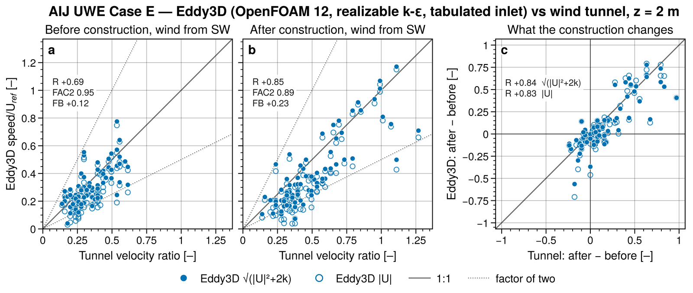</a><br><sub><a href="validation/figures/case-e-openfoam-agreement.png">1200 dpi original, 2.4 MB</a></sub><!--/fig-->

| | FAC2 | FB | q | R |
|---|---|---|---|---|
| before · √(\|U\|²+2k) | 0.95 | +0.12 | 0.61 | 0.69 |
| before · \|U\| | 0.79 | +0.27 | 0.41 | 0.69 |
| after · √(\|U\|²+2k) | 0.89 | +0.23 | 0.47 | 0.85 |
| after · \|U\| | 0.74 | +0.34 | 0.30 | 0.84 |
| ceiling control: the tunnel's *before*, scored as a model of its *after* | 0.79 | +0.37 | 0.35 | 0.10 |

<!--fig name="case-e-openfoam-bias-map.png" alt="Case E, where the model is slow or fast" width="800"--><a href="validation/figures/case-e-openfoam-bias-map.png">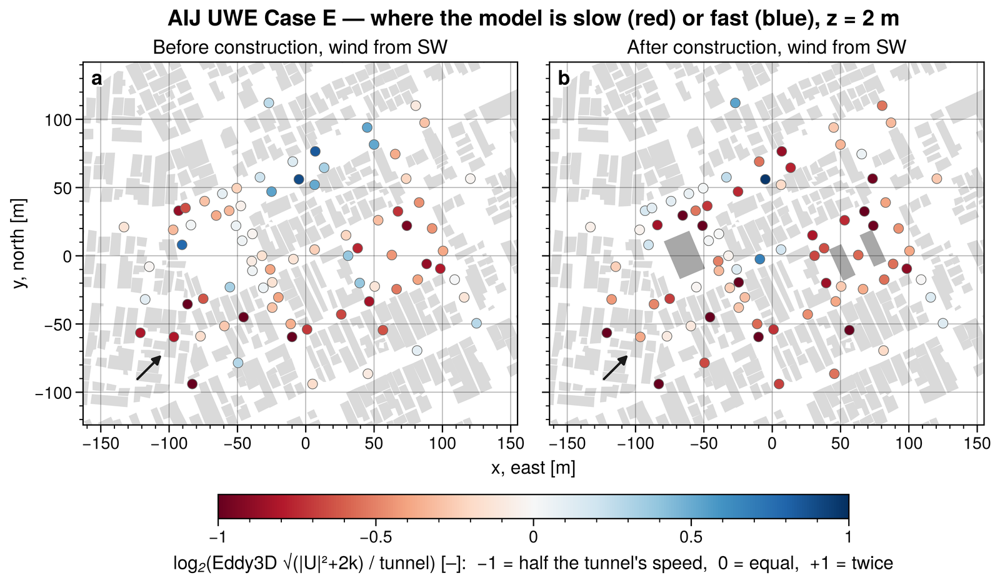</a><br><sub><a href="validation/figures/case-e-openfoam-bias-map.png">1200 dpi original, 3.6 MB</a></sub><!--/fig-->

- **The construction change is the result to read.** After − before at the 80 points, the quantity in which inflow,
  closure and instrument biases largely cancel: R = 0.84, the sign right at 57 of the 76 points where the tunnel
  resolved a change (0.75), the mean change 0.09 modelled against 0.16 measured. The model puts the speed-up and
  the shelter of the new buildings where the tunnel measured them, at about 60 % of their size — and far above
  the control that ignores the construction (R 0.10).
- **The absolute ratios are low, and the cause is not established.** An earlier version of this page read the approach
  column at 1.25 m and 2.5 m as 0.41 and 0.79 of the imposed table. Both heights lie inside the first cell of the
  coarse upstream mesh, where the probes interpolate linearly to zero at the wall, so those readings say nothing
  about the approach flow; from 5 m up it matches the table (0.98–1.04). At the measurement points the sampling is
  sound for 75 of the 80 points before construction and 79 after; the others have their 2 m sample inside the first
  cell and read low because of the sampling. The construction change, the difference of the two states, is the
  more robust result.
- SW is one of 16 directions; the others are one environment variable away and cost about 3.5 h per state each
  on this machine.

The ML surrogate (scaled ×0.9 so 2 m sits at 1.8 m) scores FB +1.00, FAC2 0.22, R +0.43, hit rate 0.08 over
all 2560 values; on the change the construction makes (after − before, 1280 pairs) it has the sign right at 67 %
of the 863 pairs the tunnel resolves (|Δ| > 0.05). See *ML surrogate* under *Validation method*.

**API.** [`cases/E.json`](docs/api/cases/E.json) · [`points.json`](docs/api/cases/E/points.json) /
[`points.csv`](docs/api/cases/E/points.csv) (2560 rows, `config` bc/ac, `wind_direction` N … NNW) ·
[`geometry.stl`](docs/api/cases/E/geometry.stl) (after construction, 8432 triangles) /
[`geometry_bc.stl`](docs/api/cases/E/geometry_bc.stl) (before, 8396), every building a closed body wound outward ·
[`validation.json`](docs/api/cases/E/validation.json)

</details>

<details>
<summary><b>Case F — Shinjuku district</b> · 472 ratios at 13 points · scored: OpenFOAM 12 (wind from NNW, two vertical frames)</summary>

<p><!--fig name="case-f.png" alt="Case F geometry" width="700"--><a href="validation/figures/geometry/case-f.png"></a><br><sub><a href="validation/figures/geometry/case-f.png">1200 dpi original, 1.9 MB</a></sub><!--/fig--><br>
<em>Shinjuku sub-centre, November 1978: terrain and buildings of the 1:800 model over a disc of 725 m radius (full-scale metres); north is +y, the towers over 100 m are blue.</em></p>

**What it is.** Shinjuku sub-centre, Tokyo, November 1978: 1:800 tunnel (thermistor, 5 / 9 / 20 m) and a year of field cup anemometers; velocity ratio to the 500 m wind, 12 tunnel and 16 field directions.

**Reference data.** `raw/cases/case-f/RS-WT_caseF.csv` (approach flow `raw/cases/case-f/AF_caseF.csv`); the cleaned table `clean/cases/F/points.csv` has 472 rows over 13 points, columns `point_id`, `config`, `instrument`, `wind_direction`, `wind_direction_deg`, `x`, `y`, `z`, `velocity_ratio`, `campaign`, `velocity_ratio_sd`.

**Frame.** Origin: centre of the reproduced district, tunnel floor plane. x: +x EAST (full-scale metres). y: +y NORTH (compass rose in MP_caseF.png). z: +z up from the TUNNEL FLOOR; the readme's rule is ground = z - 10 m (the STL's terrain under the points is at z = 5 m).

**Validation (OpenFOAM 12, realizable k-ε, full scale).** One steady solve for the wind from NNW (2,143,488 cells, 2000 iterations); the other eleven tunnel directions were not run. The thermistor and the cup anemometer read a scalar speed, so the model is scored as √(|U|²+2k) (below) and as |U| (on the Validation page), both over the model's own U(500 m) = 9.862 m/s. The readme's vertical datum and the STL's disagree by 5 m, so the model is probed in two frames, the published z in the STL's frame (*literal*) and the STL's ground plus the instrument height (*agl*), published as two runs; neither is asserted. FB is positive when the model is low.

| √(\|U\|²+2k) over U(500 m) | R (literal) | FAC2 | FB | R (agl) | FAC2 | FB |
|---|---|---|---|---|---|---|
| Tunnel, 9 m plane (13 points) | +0.935 | 1.000 | +0.036 | +0.945 | 1.000 | +0.126 |
| Tunnel, 5 m plane (7) | +0.995 | 1.000 | +0.127 | +0.918 | 1.000 | +0.128 |
| Tunnel, 20 m plane (13) | +0.796 | 0.923 | +0.071 | +0.807 | 1.000 | +0.208 |
| Tunnel, all 33 points | +0.912 | 0.970 | +0.067 | +0.898 | 1.000 | +0.165 |
| Field, 13 observations | +0.873 | 1.000 | +0.027 | +0.889 | 1.000 | +0.147 |
| Tunnel's SSE column, the opposite wind (compass control) | +0.077 | 0.615 | +0.327 | +0.102 | 0.385 | +0.413 |

The pattern follows the tunnel and the field in both frames and the level depends on the frame (FB +0.04 or +0.13 at the 9 m plane); the 20 m plane has the lowest R. The tunnel's own 9 m column scored as a model of the field gives R 0.933, FAC2 1.00 (the bar no model is expected to clear). The solved field correlates R 0.935 with the tunnel's NNW column and R 0.077 with its SSE column, which corroborates reading the direction labels as the direction the wind comes from, at this direction. The reading is on the site's [Cases F and M](https://sustainableurbansystems.com/CFD-Test-Cases-Architectural-Institute-of-Japan-AIJ/validation/cases-fm/) page.

<!--fig name="case-f-openfoam-agreement.png" alt="Case F, measured vs modelled speed" width="800"--><a href="validation/figures/case-f-openfoam-agreement.png">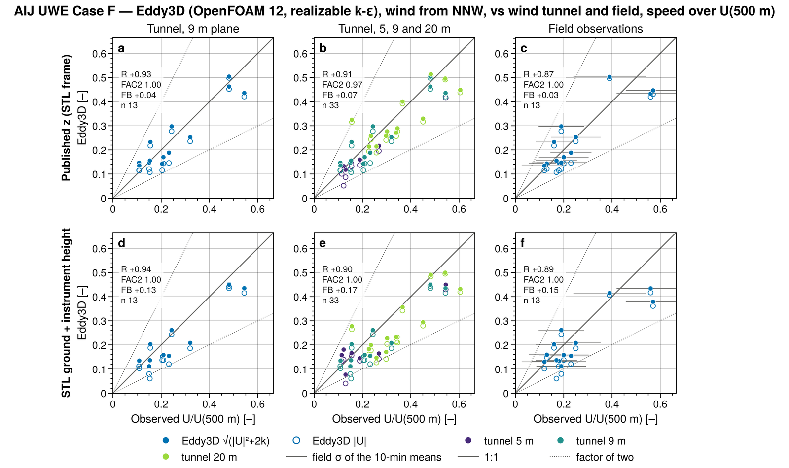</a><br><sub><a href="validation/figures/case-f-openfoam-agreement.png">1200 dpi original, 3.2 MB</a></sub><!--/fig-->

**Known issues.** 11 in the published files, listed on the [Known data issues](https://sustainableurbansystems.com/CFD-Test-Cases-Architectural-Institute-of-Japan-AIJ/known-data-issues/) page and in [`cases/F.json`](docs/api/cases/F.json).

**API.** [`cases/F.json`](docs/api/cases/F.json) · [`points.json`](docs/api/cases/F/points.json) / [`points.csv`](docs/api/cases/F/points.csv) · [`geometry.stl`](docs/api/cases/F/geometry.stl) (56,250 triangles, closed with a 1 m base slab) · [`validation.json`](docs/api/cases/F/validation.json)

</details>

<details>
<summary><b>Case G — flow behind a tree belt</b> · 28 points, U/U_H and k/U_H² · scored: OpenFOAM 12 (a drag sweep)</summary>

<p><!--fig name="case-g.png" alt="Case G geometry" width="700"--><a href="validation/figures/geometry/case-g.png"></a><br><sub><a href="validation/figures/geometry/case-g.png">1200 dpi original, 0.7 MB</a></sub><!--/fig--><br>
<em>The Tsuiji-matsu tree belt, 2 m × 74 m × 7 m with a 1.2 m gap below (full scale; shown as its envelope — a porous canopy, not a solid body); the wind blows along +x and the measurements are behind the belt.</em></p>

**What it is.** Field observation behind the Tsuiji-matsu tree belt (a porous windbreak, 74 m × 2 m × 7 m with a 1.2 m gap below): normalised mean speed and k at 28 points on the centre section (sonic anemometers).

**Reference data.** `raw/cases/case-g/RS_caseG.csv` (approach flow `raw/cases/case-g/AF_caseG.csv`); the cleaned table `clean/cases/G/points.csv` has 28 rows over 28 points, columns `point_id`, `config`, `instrument`, `wind_direction_deg`, `x`, `y`, `z`, `velocity_ratio`, `campaign`, `k_ratio`.

**Frame.** Origin: the leeward face of the tree belt at ground level, on the vertical section through the belt's centre. x: +x downwind: the belt occupies x in [-2, 0] m, the measurement lines lie behind it at x = 1.75 ... 35 m. y: +y along the belt (y in [-37, 37] m); every point is on y = 0. z: +z up; the belt spans z in [1.2, 7] m; points at z = 1.5, 3, 4.5, 6 m.

**Validation (OpenFOAM 12, realizable k-ε, full scale).** The belt's leaf area density and drag coefficient are not in the dataset, so Eddy3D solved a **drag sweep**: no belt, three vegetation-library crowns of rising Cd·LAD (0.30, 0.625 and 0.875 1/m) on a two-dimensional slab, and the conifer crown on the real 74 m belt as a half domain. Each arm is its own run and none is chosen; the arm nearest the data is a calibration against these 28 values, not a validation, and Eddy3D's trees have no canopy k source, so k is recorded only. The measurement is U/U_H and k/U_H² (U_H the wind at 7 m); the model is |U| and k over its own U(7 m) at x = −35 m. FB is positive when the model is low.

| Arm | Cd·LAD [1/m] | U R | U FAC2 | U FB | mean U/U_H | k R | k FAC2 | k FB |
|---|---|---|---|---|---|---|---|---|
| no belt (control) | 0 | +0.300 | 0.464 | −0.659 | 0.948 | −0.087 | 0.714 | +0.300 |
| pine | 0.30 | +0.503 | 1.000 | −0.425 | 0.735 | +0.213 | 0.714 | +0.138 |
| conifer | 0.625 | +0.489 | 1.000 | −0.248 | 0.613 | +0.278 | 0.750 | −0.090 |
| screen | 0.875 | +0.459 | 1.000 | −0.148 | 0.554 | +0.234 | 0.679 | −0.206 |
| conifer, real belt (half domain) | 0.625 | +0.468 | 1.000 | −0.202 | 0.585 | +0.228 | 0.750 | −0.081 |

The field's mean U/U_H is 0.478. Drag moves the level (the mean speed falls from 0.948 to 0.554 and the root-mean-square error of U from 0.474 to 0.097) and not the pattern (R stays between +0.46 and +0.50 in every arm with trees); even the densest crown leaves the mean above the measurement, so the sweep does not bracket the field. The field's k rises with distance behind the belt and the model's falls. The reading is on the site's [Cases G and K](https://sustainableurbansystems.com/CFD-Test-Cases-Architectural-Institute-of-Japan-AIJ/validation/cases-gk/) page.

<!--fig name="case-g-openfoam-sweep.png" alt="Case G, measured vs modelled, drag sweep" width="800"--><a href="validation/figures/case-g-openfoam-sweep.png">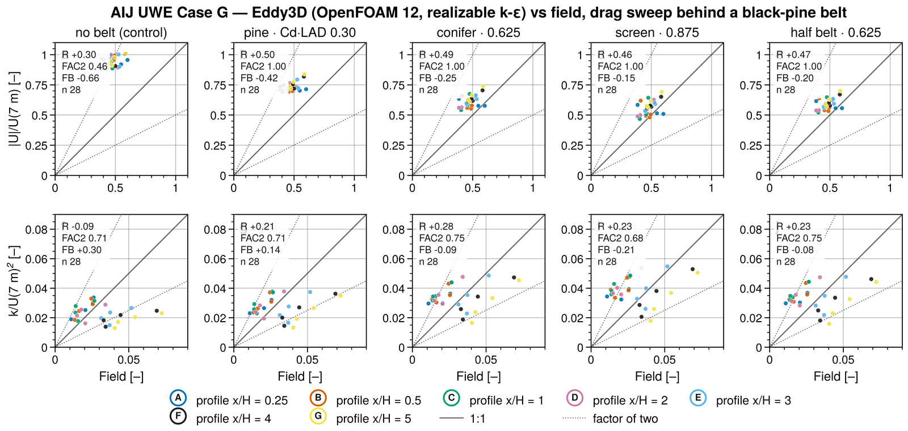</a><br><sub><a href="validation/figures/case-g-openfoam-sweep.png">1200 dpi original, 3.3 MB</a></sub><!--/fig-->

**Known issues.** 6 in the published files, listed on the [Known data issues](https://sustainableurbansystems.com/CFD-Test-Cases-Architectural-Institute-of-Japan-AIJ/known-data-issues/) page and in [`cases/G.json`](docs/api/cases/G.json).

**API.** [`cases/G.json`](docs/api/cases/G.json) · [`points.json`](docs/api/cases/G/points.json) / [`points.csv`](docs/api/cases/G/points.csv) · [`geometry.stl`](docs/api/cases/G/geometry.stl) (1 box, 12 triangles) · [`validation.json`](docs/api/cases/G/validation.json)

</details>

<details>
<summary><b>Case H — 1:1:2 building with a floor point source</b> · 1,652 rows, velocity and concentration · scored: OpenFOAM 12</summary>

<p><!--fig name="case-h.png" alt="Case H geometry" width="700"--><a href="validation/figures/geometry/case-h.png"></a><br><sub><a href="validation/figures/geometry/case-h.png">1200 dpi original, 0.9 MB</a></sub><!--/fig--><br>
<em>Isolated 1:1:2 building, 0.10 m × 0.10 m × 0.20 m (model scale); the wind blows along +x. The tracer comes from a 4 mm floor hole 0.25 H behind the leeward face (not drawn).</em></p>

**What it is.** Isolated 1:1:2 building with an ethylene point source on the floor behind it: velocity (split-fibre hot wire) and concentration (hydrocarbon analyser) at 876 points.

**Reference data.** `raw/cases/case-h/RS_caseH.csv` (approach flow `raw/cases/case-h/AF_caseH.csv`); the cleaned table `clean/cases/H/points.csv` has 1,652 rows over 876 points, columns `point_id`, `config`, `instrument`, `wind_direction_deg`, `x`, `y`, `z`, `U`, `V`, `W`, `uu`, `vv`, `ww`, `k`, `campaign`, `C`, `c_rms`, `concentration_ratio`.

**Frame.** Origin: the centre of the building's leeward face on the ground plane. x: +x streamwise (the wind blows toward +x); the building spans x in [-0.1, 0]; points at x = -0.2 ... 0.4 m. y: +y lateral; the building spans y in [-0.05, 0.05]; the z = 1/16 H plane covers y in [-0.2, 0.2]. z: +z up; roof at z = 0.2 m; points at z = 0.01 ... 0.3 m.

**Validation (OpenFOAM 12, realizable k-ε, 1:100).** Normalised by U_H (the tunnel's 3.226 m/s for the measurement, the 3.23 m/s the solve was driven with for the model; k by U_H²); the concentration is the measured C/c₀ against the model's c\* = c U_H H²/Q, scored at three turbulent Schmidt numbers. FB is positive when the model is low. Reattachment length **L_r/H = 1.36**.

| | R | FAC2 | FB | hit rate |
|---|---|---|---|---|
| U | +0.897 | 0.609 | +0.355 | 0.446 |
| V | +0.935 | 0.355 | −0.432 | 0.682 |
| W | +0.887 | 0.314 | +2.758 | 0.713 |
| k | +0.107 | 0.570 | +0.514 | 0.305 |
| c\*, Sct 0.3 | +0.954 | 0.694 | −0.597 | 0.493 |
| c\*, Sct 0.5 | +0.951 | 0.615 | −0.825 | 0.507 |
| c\*, Sct 0.7 | +0.946 | 0.588 | −0.934 | 0.493 |

The mean flow is reproduced (R 0.89 to 0.94); k is not (R 0.11); the concentration is well correlated and over-predicted at every Schmidt number (FB −0.60 to −0.93). FAC2 on V and W is low by construction, and W's FB is a near-zero mean. The reading is on the site's [Cases H and I](https://sustainableurbansystems.com/CFD-Test-Cases-Architectural-Institute-of-Japan-AIJ/validation/cases-hi/) page.

<!--fig name="cases-hi-openfoam-agreement.png" alt="Cases H and I, measured vs modelled" width="800"--><a href="validation/figures/cases-hi-openfoam-agreement.png">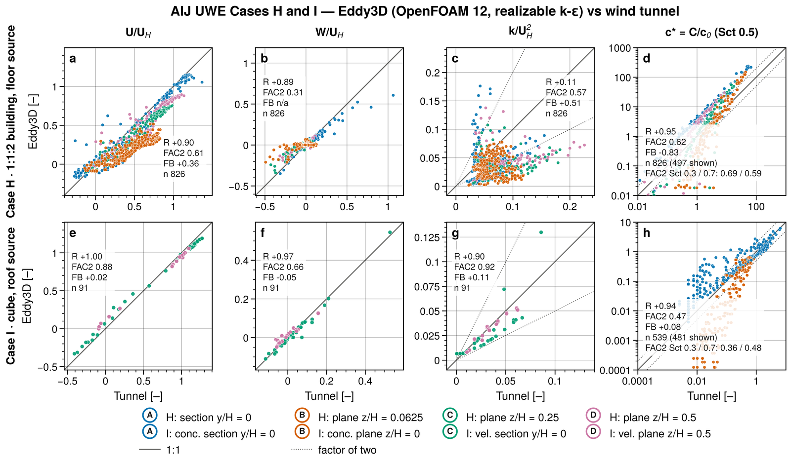</a><br><sub><a href="validation/figures/cases-hi-openfoam-agreement.png">1200 dpi original, 5.6 MB</a></sub><!--/fig-->

**Known issues.** 7 in the published files, listed on the [Known data issues](https://sustainableurbansystems.com/CFD-Test-Cases-Architectural-Institute-of-Japan-AIJ/known-data-issues/) page and in [`cases/H.json`](docs/api/cases/H.json).

**API.** [`cases/H.json`](docs/api/cases/H.json) · [`points.json`](docs/api/cases/H/points.json) / [`points.csv`](docs/api/cases/H/points.csv) · [`geometry.stl`](docs/api/cases/H/geometry.stl) (1 box, 12 triangles) · [`validation.json`](docs/api/cases/H/validation.json)

</details>

<details>
<summary><b>Case I — cube with a roof point source</b> · 630 rows, velocity and concentration · scored: OpenFOAM 12 (three closures)</summary>

<p><!--fig name="case-i.png" alt="Case I geometry" width="700"--><a href="validation/figures/geometry/case-i.png"></a><br><sub><a href="validation/figures/geometry/case-i.png">1200 dpi original, 1.0 MB</a></sub><!--/fig--><br>
<em>Isolated cube, 0.10 m on a side (model scale); the wind blows along +x. The tracer is released from a 6 mm outlet at the centre of the roof (not drawn).</em></p>

**What it is.** Isolated cube with an ethane point source at the centre of its roof: velocity (laser Doppler, 91 points) and concentration (hydrocarbon analyser, 539 points).

**Reference data.** `raw/cases/case-i/RS-w_caseI.csv` (approach flow `raw/cases/case-i/AF_caseI.csv`); the cleaned table `clean/cases/I/points.csv` has 630 rows over 630 points, columns `point_id`, `config`, `instrument`, `wind_direction_deg`, `x`, `y`, `z`, `U`, `V`, `W`, `k`, `campaign`, `C`, `concentration_ratio`.

**Frame.** Origin: the centre of the cube on the ground plane. x: +x streamwise (the wind blows toward +x); the cube spans x in [-0.05, 0.05]; wind points x = -0.15 ... 0.25 m, concentration points x = 0.065 ... 2.7 m. y: +y lateral; the cube spans y in [-0.05, 0.05]; concentration points reach |y| = 0.44 m on the ground. z: +z up; roof at z = 0.1 m; the outlet at (0, 0, 0.1).

**Validation (OpenFOAM 12, 1:60).** Realizable k-ε, standard k-ε and k-ω SST on one mesh; normalised by U_H = 1.7 m/s, k by U_H², concentration as c\* = c U_H H²/Q against the measured C/c₀. V is scored at the 38 points off the y = 0 plane, where the workbook holds numerical zeros on the plane itself. FB is positive when the model is low.

| | R | FAC2 | FB | hit rate |
|---|---|---|---|---|
| U | +0.998 | 0.879 | +0.020 | 0.813 |
| V | +0.985 | 0.895 | −2.016 | 1.000 |
| W | +0.972 | 0.659 | −0.049 | 0.967 |
| k | +0.905 | 0.923 | +0.106 | 0.582 |
| c\*, Sct 0.3 | +0.922 | 0.360 | +0.398 | 0.106 |
| c\*, Sct 0.5 | +0.940 | 0.475 | +0.083 | 0.284 |
| c\*, Sct 0.7 | +0.946 | 0.477 | −0.100 | 0.291 |

(realizable k-ε; V's FB is a near-zero mean, read its R of 0.99.) The closures: mean velocity does not separate them (U R 0.99 to 1.00); k does (FAC2 0.91 and 0.92 under the k-ε closures, 0.40 under k-ω SST), and so does the concentration (R at Sct 0.5: 0.96, 0.94 and 0.47 for standard k-ε, realizable k-ε and k-ω SST). Reattachment L_r/H: 2.23, 2.51, 2.68. This ranks three closures on one cube and one mesh, not in general. The reading is on the site's [Cases H and I](https://sustainableurbansystems.com/CFD-Test-Cases-Architectural-Institute-of-Japan-AIJ/validation/cases-hi/) page.

<!--fig name="case-i-openfoam-closures.png" alt="Case I under three turbulence closures" width="800"--><a href="validation/figures/case-i-openfoam-closures.png">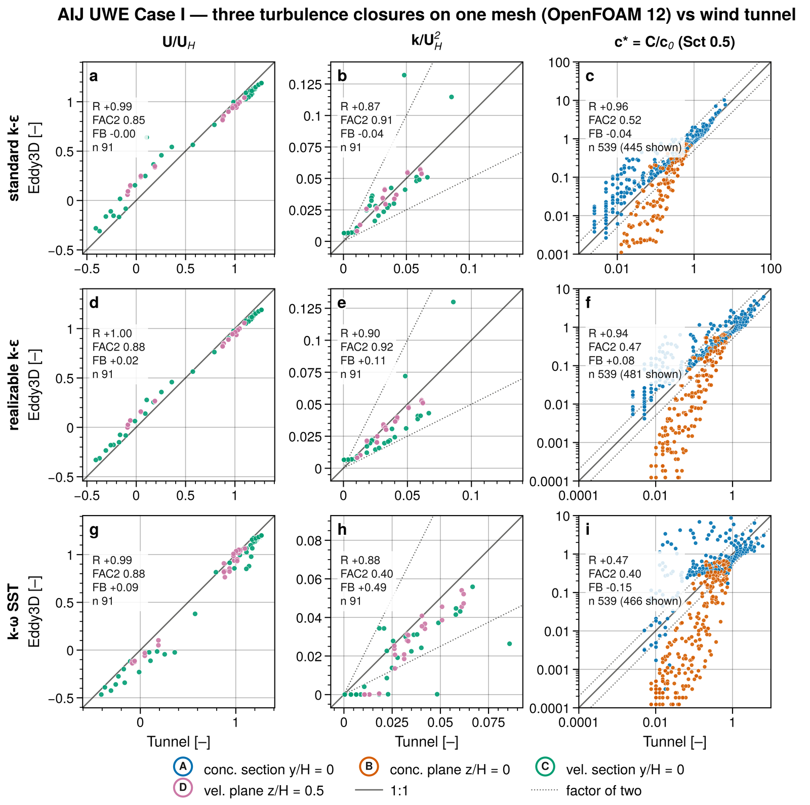</a><br><sub><a href="validation/figures/case-i-openfoam-closures.png">1200 dpi original, 5.0 MB</a></sub><!--/fig-->

**Known issues.** 8 in the published files, listed on the [Known data issues](https://sustainableurbansystems.com/CFD-Test-Cases-Architectural-Institute-of-Japan-AIJ/known-data-issues/) page and in [`cases/I.json`](docs/api/cases/I.json).

**API.** [`cases/I.json`](docs/api/cases/I.json) · [`points.json`](docs/api/cases/I/points.json) / [`points.csv`](docs/api/cases/I/points.csv) · [`geometry.stl`](docs/api/cases/I/geometry.stl) (1 box, 12 triangles) · [`validation.json`](docs/api/cases/I/validation.json)

</details>

<details>
<summary><b>Case J — 1:1:2 building, non-isothermal</b> · 444 rows, velocity, temperature, concentration, fluxes · scored: UMF (two closures)</summary>

<p><!--fig name="case-j.png" alt="Case J geometry" width="700"--><a href="validation/figures/geometry/case-j.png"></a><br><sub><a href="validation/figures/geometry/case-j.png">1200 dpi original, 1.4 MB</a></sub><!--/fig--><br>
<em>Isolated 1:1:2 building, b = 0.08 m, H = 0.16 m (model scale); the orange ring marks the floor tracer source, 0.25 H behind the building (seen through it); the wind blows along +x.</em></p>

**What it is.** Isolated 1:1:2 building with a floor tracer source in an unstably stratified boundary layer: velocity, temperature, tracer concentration and their turbulent fluxes at 444 points on three planes.

**Reference data.** `raw/cases/case-j/RS_caseJ.csv` (approach flow `raw/cases/case-j/AF_caseJ.csv`); the cleaned table `clean/cases/J/points.csv` has 444 rows over 444 points, columns `point_id`, `config`, `instrument`, `wind_direction_deg`, `x`, `y`, `z`, `U`, `V`, `W`, `uu`, `vv`, `ww`, `k`, `campaign`, `C`, `c_rms`, `concentration_ratio`, `T`, `T_rms`, `uT`, `vT`, `wT`.

**Frame.** Origin: the building's leeward (downwind) wall centre on the ground; x = 0 is the leeward wall. x: +x streamwise (the wind blows toward +x); the building spans x in [-0.08, 0]; the floor source is at x = +0.04. y: +y lateral; the building spans y in [-0.04, 0.04]; the z/H = 0.025 plane is measured on the y <= 0 side only. z: +z up; roof at z = 0.16; heated floor at z = 0.

**Validation (urbanMicroclimateFoam, Froude scale 62.5).** Eddy3D's buoyant microclimate engine, an OpenFOAM 12 solver, under its two closures, realizable k-ε and `buoyantKEpsilon`, on 236,408 air cells; the air region stopped at its 1500-iteration cap. 443 points (point 153 repeats point 1); velocities by U_H, k by U_H², temperature as θ = (T_f − T)/(T_f − T_H), the concentration as the measured C/c₀ against the modelled c\* at three turbulent Schmidt numbers. FB is positive when the model is low.

| | R (k-ε) | FAC2 | FB | R (bKε) | FAC2 | FB |
|---|---|---|---|---|---|---|
| U | +0.921 | 0.731 | +0.193 | +0.924 | 0.761 | +0.167 |
| k | +0.322 | 0.558 | −0.034 | +0.360 | 0.582 | −0.088 |
| θ | +0.922 | 1.000 | +0.120 | +0.920 | 0.998 | +0.127 |
| c\*, Sct 0.3 | +0.919 | 0.858 | +0.065 | +0.894 | 0.869 | −0.050 |
| c\*, Sct 0.5 | +0.905 | 0.847 | −0.162 | +0.869 | 0.840 | −0.274 |
| c\*, Sct 0.7 | +0.896 | 0.828 | −0.256 | +0.852 | 0.806 | −0.380 |

(k-ε is realizable k-ε, bKε is buoyantKEpsilon; V, W and the near-source split are on the Validation page.) The flow is reproduced in pattern and low in level (U R 0.92, the model's mean U/U_H 0.465 against 0.564), the recirculation is too long (reattachment 1.35 H against the measured 0.68 H at z/H = 0.25), k is not reproduced (R 0.32 to 0.36), the model is warmer than the tunnel by 3.5 K (3.6 K under bKε) on average, and the tracer's bias changes sign with the Schmidt number. The two closures differ little in the flow and more in the tracer. The reading is on the site's [Cases J and L](https://sustainableurbansystems.com/CFD-Test-Cases-Architectural-Institute-of-Japan-AIJ/validation/cases-jl/) page.

<!--fig name="case-j-umf-agreement.png" alt="Case J, measured vs modelled, two closures" width="800"--><a href="validation/figures/case-j-umf-agreement.png">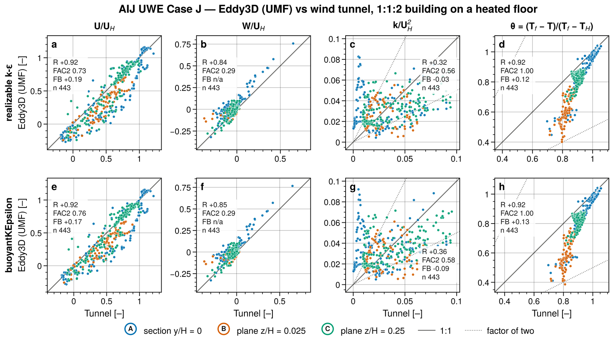</a><br><sub><a href="validation/figures/case-j-umf-agreement.png">1200 dpi original, 5.7 MB</a></sub><!--/fig-->

**Known issues.** 10 in the published files, listed on the [Known data issues](https://sustainableurbansystems.com/CFD-Test-Cases-Architectural-Institute-of-Japan-AIJ/known-data-issues/) page and in [`cases/J.json`](docs/api/cases/J.json).

**API.** [`cases/J.json`](docs/api/cases/J.json) · [`points.json`](docs/api/cases/J/points.json) / [`points.csv`](docs/api/cases/J/points.csv) · [`geometry.stl`](docs/api/cases/J/geometry.stl) (1 box, 12 triangles) · [`validation.json`](docs/api/cases/J/validation.json)

</details>

<details>
<summary><b>Case K — 9 x 9 cube array, point source</b> · 203 rows, velocity and concentration · scored: OpenFOAM 12</summary>

<p><!--fig name="case-k.png" alt="Case K geometry" width="700"--><a href="validation/figures/geometry/case-k.png"></a><br><sub><a href="validation/figures/geometry/case-k.png">1200 dpi original, 2.0 MB</a></sub><!--/fig--><br>
<em>9 x 9 array of 0.06 m cubes on a 0.12 m pitch (model scale); the orange ring marks the floor tracer source between rows 2 and 3; the wind blows along +x.</em></p>

**What it is.** 9 x 9 array of 0.06 m cubes with a tracer point source on the floor between rows 2 and 3: velocity and tracer concentration at 203 points in the streets and over the first rows.

**Reference data.** `raw/cases/case-k/RS_caseK.csv` (approach flow `raw/cases/case-k/AF_caseK.csv`); the cleaned table `clean/cases/K/points.csv` has 203 rows over 203 points, columns `point_id`, `config`, `instrument`, `wind_direction_deg`, `x`, `y`, `z`, `U`, `V`, `W`, `uu`, `vv`, `ww`, `k`, `campaign`, `C`, `c_rms`, `concentration_ratio`.

**Frame.** Origin: bottom centre of the windward wall of the 4th row of the central column: x = 0 is that wall, y = 0 the centre line of the central column. x: +x streamwise (the wind blows toward +x); row k spans x in [0.12 (k-4), 0.12 (k-4) + 0.06], so the array spans x in [-0.36, 0.66]. y: +y lateral; column centres at y = 0, +-0.12, ... +-0.48 (the array spans y in [-0.51, 0.51]). z: +z up; cube tops at z = 0.06.

**Validation (OpenFOAM 12, realizable k-ε, 1:100).** 972,637 cells; the solve ran to its 3000-iteration limit. Measured and modelled velocities are both divided by the stated U_H = 2.33 m/s and k by U_H²; the model is driven by the measured approach profile, which gives 1.97 m/s at z = H. The concentration is the measured C/c₀ against the modelled c\* at three turbulent Schmidt numbers. FB is positive when the model is low.

| | R | FAC2 | FB | hit rate |
|---|---|---|---|---|
| U | +0.958 | 0.586 | +0.594 | 0.123 |
| V | −0.151 | 0.054 | — | 0.901 |
| W | +0.573 | 0.143 | — | 0.685 |
| k | +0.330 | 0.044 | +1.201 | 0.005 |
| c\*, Sct 0.3 | +0.953 | 0.793 | −0.690 | 0.458 |
| c\*, Sct 0.5 | +0.951 | 0.685 | −0.875 | 0.163 |
| c\*, Sct 0.7 | +0.950 | 0.394 | −0.983 | 0.099 |

The velocity pattern is reproduced and the level is low (mean U/U_H 0.272 against 0.502); k is a factor of four low (R 0.33); V has a constant offset in the tunnel, so a model with V = 0 hits 0.91 of the points and V's hit rate scores nothing. The concentration is correlated at every Schmidt number (R 0.95) and high (FB −0.69 to −0.98); the four points within one cube height of the source, where the model's source is a zone of four cells, are 3.7 to 5.1 times too high on average. The reading is on the site's [Cases G and K](https://sustainableurbansystems.com/CFD-Test-Cases-Architectural-Institute-of-Japan-AIJ/validation/cases-gk/) page.

<!--fig name="case-k-openfoam-agreement.png" alt="Case K, measured vs modelled" width="800"--><a href="validation/figures/case-k-openfoam-agreement.png">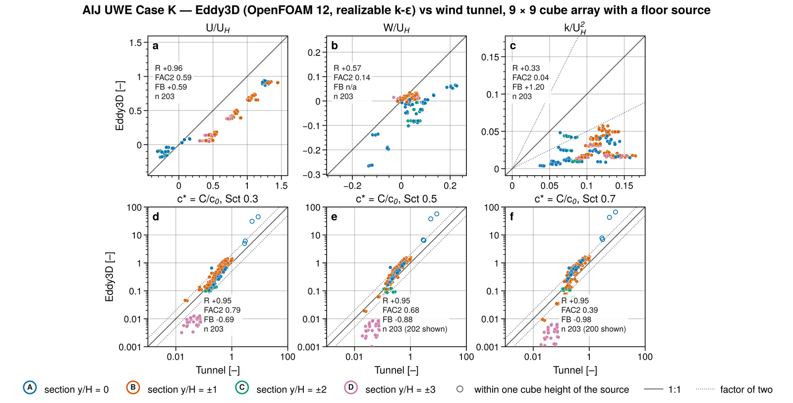</a><br><sub><a href="validation/figures/case-k-openfoam-agreement.png">1200 dpi original, 3.6 MB</a></sub><!--/fig-->

**Known issues.** 9 in the published files, listed on the [Known data issues](https://sustainableurbansystems.com/CFD-Test-Cases-Architectural-Institute-of-Japan-AIJ/known-data-issues/) page and in [`cases/K.json`](docs/api/cases/K.json).

**API.** [`cases/K.json`](docs/api/cases/K.json) · [`points.json`](docs/api/cases/K/points.json) / [`points.csv`](docs/api/cases/K/points.csv) · [`geometry.stl`](docs/api/cases/K/geometry.stl) (1 box, 972 triangles) · [`validation.json`](docs/api/cases/K/validation.json)

</details>

<details>
<summary><b>Case L — 9 x 14 cube array, line source, non-isothermal</b> · 344 rows, velocity, temperature, concentration, fluxes · scored: UMF</summary>

<p><!--fig name="case-l.png" alt="Case L geometry" width="700"--><a href="validation/figures/geometry/case-l.png"></a><br><sub><a href="validation/figures/geometry/case-l.png">1200 dpi original, 2.3 MB</a></sub><!--/fig--><br>
<em>14 x 9 array of 0.06 m cubes on a 0.12 m pitch (model scale); the orange line is the floor tracer source between rows 7 and 8; the wind blows along +x.</em></p>

**What it is.** 14 rows by 9 columns of 0.06 m cubes with a tracer line source on the floor across the tunnel, in an unstably stratified boundary layer: velocity, temperature, concentration and their fluxes at 344 points in the streets and over the roofs.

**Reference data.** `raw/cases/case-l/RS_caseL.csv` (approach flow `raw/cases/case-l/AF_caseL.csv`); the cleaned table `clean/cases/L/points.csv` has 344 rows over 344 points, columns `point_id`, `config`, `instrument`, `wind_direction_deg`, `x`, `y`, `z`, `U`, `V`, `W`, `uu`, `vv`, `ww`, `k`, `campaign`, `uv`, `uw`, `C`, `c_rms`, `concentration_ratio`, `T`, `T_rms`, `uc`, `vc`, `wc`, `uT`, `vT`, `wT`.

**Frame.** Origin: bottom centre of the windward wall of the 9th row (of 14) of the central column: x = 0 is that wall, y = 0 the centre line of the central column. x: +x streamwise (the wind blows toward +x); row k spans x in [0.12 (k-9), 0.12 (k-9) + 0.06], so the array spans x in [-0.96, 0.66]. y: +y lateral; column centres at y = 0, +-0.12, ... +-0.48 (the array spans y in [-0.51, 0.51]). z: +z up from the model floor; cube tops at z = 0.06; heated floor at z = 0.

**Validation (urbanMicroclimateFoam, Froude scale 100, realizable k-ε).** 754,940 air cells; the air region stopped at its 1500-iteration cap. Velocities by U_H, k by U_H², temperature as θ = (T_f − T)/(T_f − T_H), the concentration as the measured C/c₀ against the modelled c\* at three turbulent Schmidt numbers. The 51 points at z = 4 mm lie inside the model's first cell; the 242 at or above 30 mm are scored separately on the Validation page. FB is positive when the model is low.

| | R | FAC2 | FB | hit rate |
|---|---|---|---|---|
| U | +0.918 | 0.608 | +0.268 | 0.506 |
| V | −0.037 | 0.291 | −0.795 | 0.747 |
| W | −0.027 | 0.183 | — | 0.762 |
| k | +0.145 | 0.584 | +0.635 | 0.244 |
| θ | +0.936 | 1.000 | +0.049 | 0.985 |
| c\*, Sct 0.3 | +0.798 | 0.759 | −0.498 | 0.468 |
| c\*, Sct 0.5 | +0.766 | 0.683 | −0.649 | 0.387 |
| c\*, Sct 0.7 | +0.746 | 0.602 | −0.731 | 0.358 |

U and θ follow the tunnel (the model beats the undisturbed approach column on R: 0.918 against 0.861 for U), but the street air is nearly stagnant in the model (mean U/U_H 0.045 below 30 mm, the tunnel's 0.297), V and W carry no pattern, k is low (R 0.15), the model is warmer by 1.2 K on average, and the tracer is correlated (R 0.75 to 0.80) and high (FB −0.50 to −0.73). The reading is on the site's [Cases J and L](https://sustainableurbansystems.com/CFD-Test-Cases-Architectural-Institute-of-Japan-AIJ/validation/cases-jl/) page.

<!--fig name="case-l-umf-agreement.png" alt="Case L, measured vs modelled" width="800"--><a href="validation/figures/case-l-umf-agreement.png">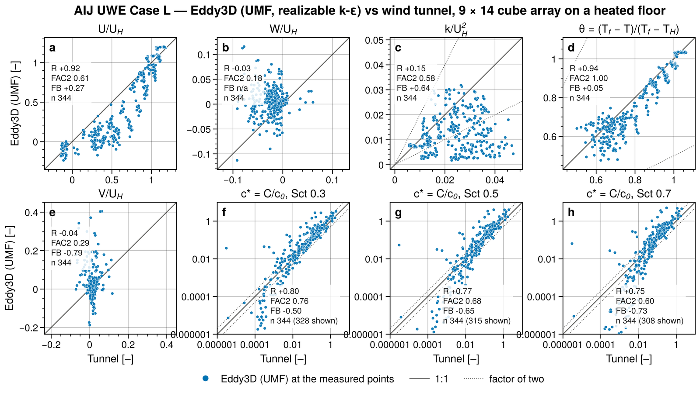</a><br><sub><a href="validation/figures/case-l-umf-agreement.png">1200 dpi original, 5.3 MB</a></sub><!--/fig-->

**Known issues.** 9 in the published files, listed on the [Known data issues](https://sustainableurbansystems.com/CFD-Test-Cases-Architectural-Institute-of-Japan-AIJ/known-data-issues/) page and in [`cases/L.json`](docs/api/cases/L.json).

**API.** [`cases/L.json`](docs/api/cases/L.json) · [`points.json`](docs/api/cases/L/points.json) / [`points.csv`](docs/api/cases/L/points.csv) · [`geometry.stl`](docs/api/cases/L/geometry.stl) (1 box, 1,512 triangles) · [`validation.json`](docs/api/cases/L/validation.json)

</details>

<details>
<summary><b>Case M — TPU Atsugi campus</b> · 330 rows, tunnel and field · scored: OpenFOAM 12 (WD 180, three Schmidt numbers)</summary>

<p><!--fig name="case-m.png" alt="Case M geometry" width="700"--><a href="validation/figures/geometry/case-m.png"></a><br><sub><a href="validation/figures/geometry/case-m.png">1200 dpi original, 1.8 MB</a></sub><!--/fig--><br>
<em>TPU Atsugi campus: terrain and buildings of the 1:600 model (full-scale metres, 1080 m by 720 m); the arrow is the wind at WD = 180°, blowing toward +x (north).</em></p>

**What it is.** Tracer-gas release on the Tokyo Polytechnic University Atsugi campus: 1:600 tunnel (velocity at 180°, ethylene concentration at 175°, 180° and 185°) and 18 field runs with PMCH, 15 points 3 m above ground.

**Reference data.** `raw/cases/case-m/RS-WT_caseM.csv` (approach flow `raw/cases/case-m/AF_caseM.csv`); the cleaned table `clean/cases/M/points.csv` has 330 rows over 15 points, columns `point_id`, `config`, `instrument`, `wind_direction_deg`, `x`, `y`, `z`, `U`, `V`, `W`, `uu`, `vv`, `ww`, `k`, `campaign`, `run`, `C`, `c_rms`, `concentration_ratio`.

**Frame.** Origin: centre of the tunnel turntable on the floor plane (ground surface there at z = 33.07 m). x: +x NORTH (full-scale metres). y: +y WEST (compass rose of MP_caseM.png: N at +x, W at +y); the frame is right-handed. z: +z up from the TUNNEL FLOOR; the campus ground lies at z ~ 32 m.

**Validation (OpenFOAM 12, realizable k-ε, full scale).** One steady solve at WD 180, the tunnel's only heading with velocities (1,394,053 cells, 3000 iterations). U, V, W and k are over the tunnel's U<sub>R</sub> = 4.08 m/s (measured) and over the solved speed at the reference mast (modelled); the concentration is the measured C/c₀ against the model's c\* = c U<sub>R</sub> H<sub>R</sub>²/Q at three turbulent Schmidt numbers, three runs on one flow, published side by side. FB is positive when the model is low.

| | R | FAC2 | FB | hit rate |
|---|---|---|---|---|
| c\*, Sct 0.3 | +0.412 | 0.200 | +1.396 | 0.133 |
| c\*, Sct 0.5 | +0.251 | 0.200 | +1.524 | 0.133 |
| c\*, Sct 0.7 | +0.198 | 0.133 | +1.579 | 0.133 |
| U | +0.708 | 0.267 | +1.460 | 0.267 |
| V | +0.731 | 0.333 | — | 0.133 |
| W | +0.181 | 0.267 | — | 0.733 |
| \|U\| | +0.601 | 0.733 | +0.185 | 0.400 |
| k | +0.446 | 0.133 | +1.131 | 0.067 |

The tracer is under-predicted at every Schmidt number (the model's mean c\* is 0.12 to 0.18 against the tunnel's 1.00, its peak 1.27 to 1.38 against 3.04), and the points mirrored across the plume axis score R +0.65 to +0.68, better than the real points' +0.20 to +0.41: the modelled plume is displaced sideways against the tunnel's. The three points nearest the source carry c\* 2.52 in the tunnel and 0.26, 0.11 and 0.05 in the model (the ordering the fixture first asserted, now recorded: at Sct 0.7 the near points carry less than the two far ones, 0.055 against 0.087); the tunnel's own WD 175 and WD 185 reach FAC2 0.73 and 0.80 against its WD 180, the model 0.13 to 0.20. The mean streamwise velocity is low (U/U<sub>R</sub> 0.026 against 0.164) while the magnitude is close (|U| FB +0.19). The 18 field runs are recorded beside it and never asserted. The reading is on the site's [Cases F and M](https://sustainableurbansystems.com/CFD-Test-Cases-Architectural-Institute-of-Japan-AIJ/validation/cases-fm/) page.

<!--fig name="case-m-openfoam-agreement.png" alt="Case M, measured vs modelled velocity and concentration" width="800"--><a href="validation/figures/case-m-openfoam-agreement.png">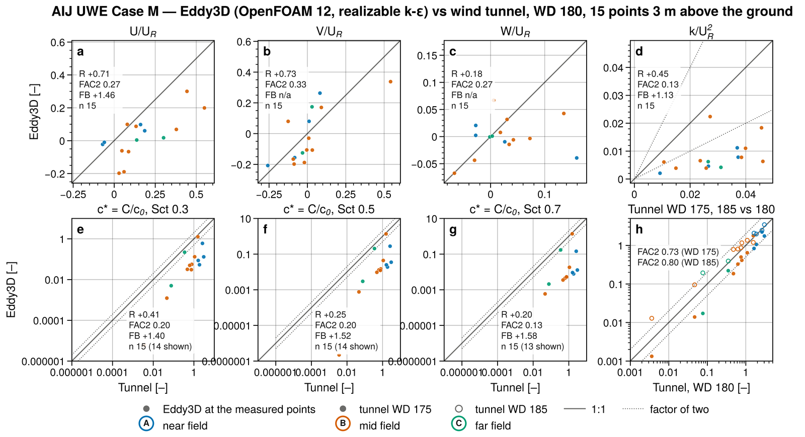</a><br><sub><a href="validation/figures/case-m-openfoam-agreement.png">1200 dpi original, 2.9 MB</a></sub><!--/fig-->

**Known issues.** 10 in the published files, listed on the [Known data issues](https://sustainableurbansystems.com/CFD-Test-Cases-Architectural-Institute-of-Japan-AIJ/known-data-issues/) page and in [`cases/M.json`](docs/api/cases/M.json).

**API.** [`cases/M.json`](docs/api/cases/M.json) · [`points.json`](docs/api/cases/M/points.json) / [`points.csv`](docs/api/cases/M/points.csv) · [`geometry.stl`](docs/api/cases/M/geometry.stl) (43,950 triangles, closed with a 1 m base slab) · [`validation.json`](docs/api/cases/M/validation.json)

</details>

---

<details>
<summary><b>Validation method</b> · how Eddy3D is scored, the figures, the ML surrogate, what is scored and why</summary>

Each case is solved through Eddy3D's production case writer (`build-case → run → probe`), not a
hand-built OpenFOAM case, so what is validated is what a user gets. The probe sits at **exactly the
tunnel's own measurement coordinates**, so no interpolation enters the comparison. Cases C–E measure an
omnidirectional *scalar* speed with thermistors, so the model is scored as √(|U|² + 2k) and as |U| — the two
ends of the bracket the measurement has to fall in. Case C's figures and reading are in its own section above.

### Cases A and B — does the model agree?

<!--fig name="cases-ab-openfoam-agreement.png" alt="Measured vs modelled, Cases A and B" width="800"--><a href="validation/figures/cases-ab-openfoam-agreement.png">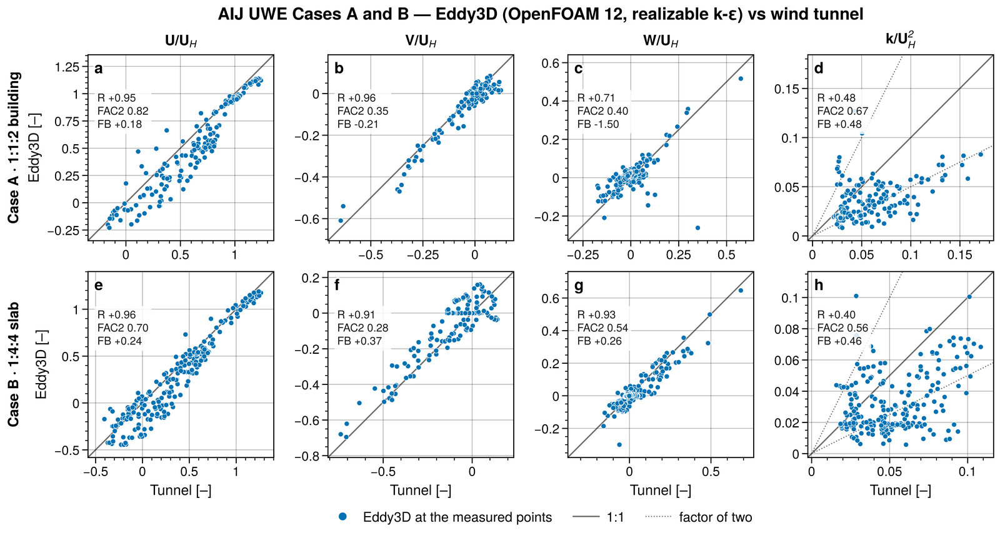</a><br><sub><a href="validation/figures/cases-ab-openfoam-agreement.png">1200 dpi original, 3.4 MB</a></sub><!--/fig-->

Measured against modelled for each quantity, with the 1:1 line and, where the quantity does not
change sign, the factor-of-two band.

| | A — U | A — V | A — W | A — k | B — U | B — V | B — W | B — k |
|---|---|---|---|---|---|---|---|---|
| **R** | +0.955 | +0.961 | +0.708 | +0.480 | +0.959 | +0.910 | +0.929 | +0.399 |
| **FAC2** | 0.817 | 0.349 | 0.398 | 0.667 | 0.701 | 0.281 | 0.536 | 0.562 |
| **FB** | +0.185 | −0.207 | −1.501 | +0.478 | +0.240 | +0.370 | +0.263 | +0.463 |
| **hit rate** | 0.586 | 0.892 | 0.801 | 0.177 | 0.562 | 0.612 | 0.808 | 0.223 |

Normalised by U_H throughout, the benchmark's own convention. Hit rate uses D = 0.25, W = 0.05 U_H.
Reattachment length behind the building: **L_r/H = 1.49** (Case A), **3.27** (Case B).

Reading these honestly:

- **The streamwise field is right** — R ≈ 0.96 in both cases, FAC2 0.82 / 0.70.
- **k is under-predicted in both** (FB ≈ +0.47, R ≈ 0.4), the familiar realizable k-ε behaviour and
  consistent with what Eddy3D already records for AIJ Case H.
- **FAC2 on V and W is low by construction, not by failure.** Those components change sign, so
  factor-of-two agreement is a harsh measure near zero; R and hit rate are the meaningful columns
  there. The flat row of model V ≈ 0 in Case B's panel is the symmetry plane: a RANS solution is
  symmetric, so V ≡ 0 at y = 0, while the tunnel measures small non-zero values.
- **Case A's W FB of −1.50 and its NMSE are artefacts of a near-zero mean** (mean measured W is
  ~0.01 m/s), not a blow-up. Read R = +0.71 instead.

### Cases A and B — where does it agree?

<!--fig name="cases-ab-openfoam-profiles.png" alt="Centre-plane profiles, Cases A and B" width="800"--><a href="validation/figures/cases-ab-openfoam-profiles.png">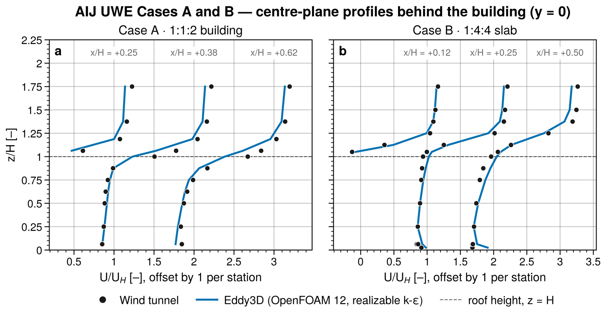</a><br><sub><a href="validation/figures/cases-ab-openfoam-profiles.png">1200 dpi original, 1.0 MB</a></sub><!--/fig-->

Vertical profiles of U/U_H on the centre plane at the first three measured stations behind the
building, offset per station. The model follows the measured profile closely above roof height and
in the recovering wake; the near-ground deficit immediately behind the building is where the
closure does least well.

### Cases A and B — every engine on the same points

<!--fig name="cases-ab-engine-comparison.png" alt="Measured vs modelled U and V, Cases A and B, one row per engine" width="800"--><a href="validation/figures/cases-ab-engine-comparison.png">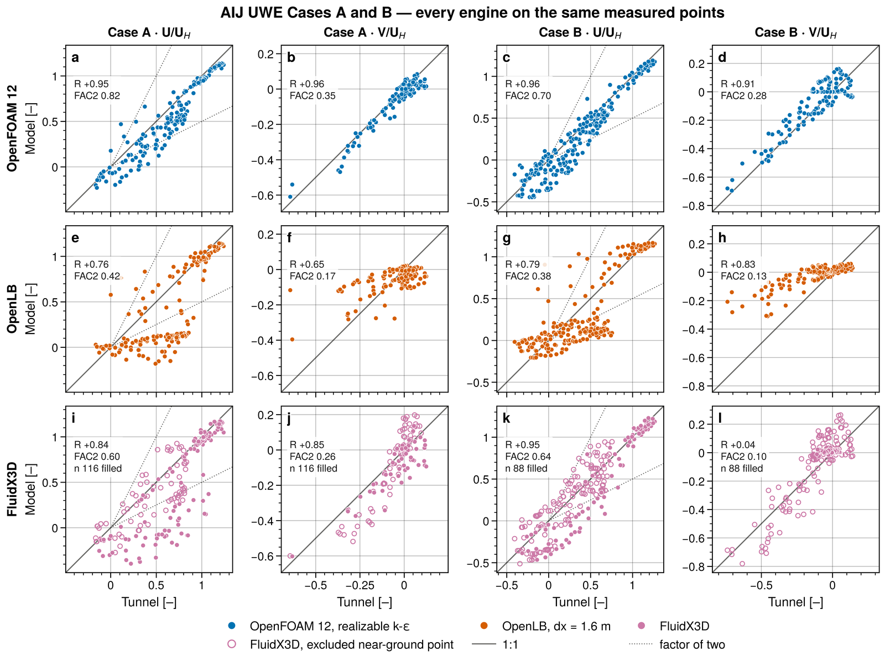</a><br><sub><a href="validation/figures/cases-ab-engine-comparison.png">1200 dpi original, 5.1 MB</a></sub><!--/fig-->

OpenLB (Eddy3D's `eddy3dWind`: Smagorinsky, third-order regularised D3Q19, CPU image) solved the same two
experiments with the same fitted inflow and probed the same measured points, at dx = 1.6 m — H/10 for A, H/12.5
for B, 1.3 and 2.6 million cells, 1.8 h and 4.1 h on four threads. That is a screening resolution: H/20 costs about
16 times the cell-steps on this image.

| case · quantity | n | FAC2 | FB | q | R | OpenFOAM FAC2 / q / R |
|---|---|---|---|---|---|---|
| A · U/U_H, all points | 186 | 0.43 | +0.40 | 0.37 | 0.76 | 0.82 / 0.59 / 0.96 |
| A · U/U_H, points ≥ 2 cells above the floor | 121 | 0.65 | +0.17 | 0.56 | 0.81 | — |
| A · V/U_H | 186 | 0.17 | — | 0.62 | 0.65 | 0.35 / 0.89 / 0.96 |
| A · W/U_H | 186 | 0.12 | — | 0.59 | 0.54 | 0.40 / 0.80 / 0.71 |
| B · U/U_H, all points | 224 | 0.38 | +0.28 | 0.29 | 0.79 | 0.70 / 0.56 / 0.96 |
| B · U/U_H, points ≥ 2 cells above the floor | 95 | 0.64 | −0.07 | 0.52 | 0.90 | — |
| B · V/U_H | 224 | 0.13 | — | 0.55 | 0.83 | 0.28 / 0.61 / 0.91 |
| B · W/U_H | 224 | 0.24 | — | 0.65 | 0.77 | 0.54 / 0.81 / 0.93 |

Reading these:

- **The flat band of near-zero model U in the OpenLB row is the floor.** OpenLB meets the ground with a plain
  no-slip (bounce-back) wall and carries the roughness only in the inlet profile; in the undisturbed column at
  the windward face its U is 0.29 of the inlet log law one cell up, 0.69 at two, 0.95 at three and 1.02–1.07
  from four. Case A's lowest plane sits 0.6 cells up, so above two cells FAC2 rises to 0.65 and FB falls to +0.17.
- **The solve is nearly steady.** The resolved k is 0.7 % (A) and 10 % (B) of the measured one: a steady
  log-law inflow at H/10 resolves almost no turbulence, so k is not compared, and with nothing to entrain the
  wakes run long (A: L_r = 3.39 H against OpenFOAM's 1.49) or displaced (B: its field fits best sampled H/2
  downstream).
- **Its frame is right:** with the lateral sign flipped V's R becomes −0.65 (A) and −0.83 (B), and U scrambled
  across the points drops R to 0.10.
- Each number above was reproduced from the solver's own probe output against the original Zenodo CSVs (largest
  difference 1 × 10⁻¹⁵).
- At this spacing Case B first crashed: OpenLB's STL reader segfaults when lattice nodes sit exactly on its
  octree planes. Eddy3D now moves such a lattice by 10⁻⁴ dx (`LBMCaseXml`), with a regression test that fails
  without the move.

**FluidX3D** (Eddy3D's GPU lattice-Boltzmann engine: D3Q19 with Smagorinsky LES) solved both experiments at dx =
H/64 (2.5 mm and 3.125 mm; 117 and 121 million cells) with the same fitted log-law inflow, averaging over 200 H/U_H
after 40 of spin-up (A) and over 500 after 100 (B). Each run has an empty-domain control on the same lattice, and a
point is scored only at a height where that control holds the imposed log law within 5 %: 116 of Case A's 186 points
and 88 of Case B's 224.

| case · quantity, comparable heights | n | FAC2 | FB | q | R | OpenFOAM on the same points: FAC2 / q / R |
|---|---|---|---|---|---|---|
| A · U/U_H | 116 | 0.60 | +0.41 | 0.57 | 0.84 | 0.85 / 0.73 / 0.95 |
| A · V/U_H | 116 | 0.26 | — | 0.75 | 0.85 | 0.27 / 0.90 / 0.95 |
| A · W/U_H | 116 | 0.22 | — | 0.41 | 0.59 | 0.49 / 0.79 / 0.93 |
| B · U/U_H | 88 | 0.64 | +0.26 | 0.57 | 0.95 | 0.78 / 0.68 / 0.97 |
| B · W/U_H | 88 | 0.48 | — | 0.32 | 0.85 | 0.78 / 0.69 / 0.95 |

Reading these:

- **The excluded points are the floor again.** FluidX3D meets the ground with a bounce-back wall and no roughness
  wall function. In the empty domain the flow at Case A's lowest plane (z = 0.01 m, 4 cells up) reads 0.52 of the
  imposed log law on average, and 0.86 at z = 0.04 m; Case B's three lowest heights read 0.77, 0.58 and 0.93. Those
  points are scored separately (`velocity.*.excluded`) and drawn hollow in the figure.
- **On Case A, the approach flow alone scores better on U.** On the comparable points, the empty-domain flow, with
  no building at all, scores U FAC2 0.77, FB −0.26 and hit rate 0.59, against the solved field's 0.60, +0.41 and
  0.57. Only the correlation shows the building's effect (0.84 against 0.51). On Case B the solved field beats its
  approach flow on every U statistic (FAC2 0.64 against 0.56, R 0.95 against 0.81).
- **Case B's V is not a headline score.** All 88 comparable points lie on the centre plane, where the mean V is zero
  by symmetry.
- **Its frame is right:** with the lateral sign flipped, Case A's V correlation becomes −0.85.
- Every number above was reproduced from the solver's own probe output against the cleaned tables, with the
  comparable set derived independently (largest difference 3 × 10⁻¹²).

### ML surrogate

<!--fig name="ml-surrogate-agreement.png" alt="Measured vs predicted, ML surrogate, Cases A–E" width="800"--><a href="validation/figures/ml-surrogate-agreement.png">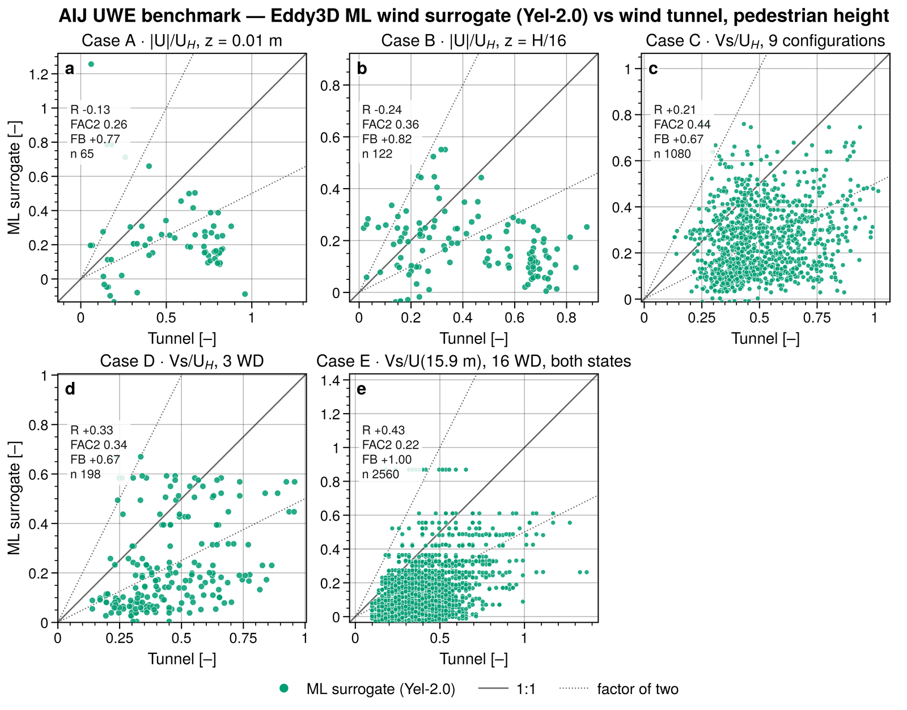</a><br><sub><a href="validation/figures/ml-surrogate-agreement.png">1200 dpi original, 5.4 MB</a></sub><!--/fig-->

Eddy3D's Wind Predictor (the public `Yel-2.0` network) predicts |U_mean|/U_ref at one height, 1.8 m. Each case is
therefore scaled so its measurement plane lands there — A ×180, B ×144, C ×90, D ×360, E ×0.9 — its buildings are
rasterised onto the model's 504 × 504 lattice of 2 m cells with the shipped grid code, the prediction is read at
the tunnel's own sensor coordinates, and U_ref (the approach speed 10 m above the scaled ground) is converted to
U_H with each case's approach-flow file. The scores use the same metric code and settings as the OpenFOAM rows.

| case · quantity | n | FB | FAC2 | R | hit rate | OpenFOAM, same points and quantity |
|---|---|---|---|---|---|---|
| A · \|U\|/U_H, z = 0.01 m plane | 65 | +0.77 | 0.26 | −0.13 | 0.09 | FB +0.27, FAC2 0.85, R +0.90, hit rate 0.45 |
| B · \|U\|/U_H, z = H/16 plane | 122 | +0.82 | 0.36 | −0.24 | 0.17 | FB +0.12, FAC2 0.84, R +0.87, hit rate 0.57 |
| C · Vs/U_H, 9 configurations | 1080 | +0.67 | 0.44 | +0.21 | 0.18 | √(\|U\|²+2k): FB +0.18, FAC2 0.93, R +0.87, hit rate 0.69 |
| D · Vs/U_H, thermistor, 3 WD | 198 | +0.67 | 0.34 | +0.33 | 0.17 | WD 0°, 22.5° and 45° (66 points each): √(\|U\|²+2k) FB +0.21 / +0.05 / +0.09, FAC2 0.73 / 0.92 / 0.89, R +0.80 / +0.80 / +0.85 |
| D · \|U\|/U_H, split fibre, WD 0 | 33 | +0.23 | 0.52 | +0.59 | 0.24 | FB +0.07, FAC2 0.76, R +0.85, hit rate 0.52 |
| E · Vs/U(15.9 m), 16 WD, before + after | 2560 | +1.00 | 0.22 | +0.43 | 0.08 | — |
| E · the same, SW only (both states) | 160 | +1.07 | 0.20 | +0.53 | 0.04 | \|U\|: FB +0.31, FAC2 0.76, R +0.81, hit rate 0.36 |

**It predicts roughly half the tunnel's speed everywhere** (FB +0.67 … +1.00 on the thermistor cases), and
**it does not respond to the wind direction**. Reversing the wind (θ + 180°) changes the predicted field by at most
1 × 10⁻⁴ U_ref over all 254,016 cells, in every case. Perturbing one input channel at a time shows why: the network
responds to spatial *contrast* in a channel, never to its level, and on a lattice that fills the window the two
direction channels are constant planes. Cut the lattice at ±250 m and the direction enters through the step at its
edge — the field then moves by up to ~1 U_ref — but not in the measurement's favour: on A, B and D the reversed
wind scores as well as the right one or better. So these numbers grade the geometry the model was given, not a
wind it was told; a model that cannot tell upwind from downwind cannot be validated on a wake. In Eddy3D,
`WindPredictorCMP` should warn when its direction channels carry no contrast.

### Metrics

R is Pearson's correlation; FAC2 the fraction of points within a factor of two; FB the fractional bias
2(ō − p̄)/(ō + p̄), positive when the model is low; hit rate the fraction within D = 0.25 relative or
W = 0.05 U_H absolute. NMSE, NAD, MG and VG are in `validation/results/*.json` and the API's `validation.json`.

### Inflow

Fitted to each case's own approach-flow file rather than assumed (Cases C–E: in their sections above):

| Case | u\* (m/s) | z₀ (mm) | U_H measured (m/s) | log-law error |
|---|---|---|---|---|
| A | 0.343 | 0.668 | 4.491 | +2.0 % |
| B | 0.399 | 0.882 | 5.133 | +2.9 % |

**Sampling near the ground.** The probes interpolate from cell centres to points, and at a wall the point value of
the velocity is zero, so below the centre of the first cell a sample grows linearly from zero whatever the flow
does. Upstream, where the background mesh is coarse, the pedestrian heights fall in that layer, so the approach
flow cannot be read there at 2 m. An earlier version of this page read it as 17 % slow in Case C and as 0.41 and
0.79 of the table at 1.25 m and 2.5 m in Case E; both were this artefact (the sampled |U| is proportional to z).
At the measurement points, inside the refined mesh, it affects 0 of 240 points checked in Case C, 2 of 78 in Case D
(both sheltered and nearly still) and 5 of 80 (before construction) and 1 of 80 (after) in Case E. Reading the
approach flow at pedestrian height needs a refined upstream column or sampling consistent with the wall function.

### Reproducing the figures

`validation/plot_cases_ab_openfoam.py` (Cases A and B), `validation/plot_cases_ab_engines.py` (A and B, every engine),
`validation/plot_case_c_openfoam.py`, `validation/plot_case_d_openfoam.py`, `validation/plot_case_e_openfoam.py`,
`validation/plot_cases_hi_openfoam.py` (Cases H and I), `validation/plot_cases_gk_openfoam.py` (Cases G and K),
`validation/plot_cases_jl_umf.py` (Cases J and L, on UMF), `validation/plot_cases_fm_openfoam.py` (Cases F and M) and `validation/plot_ml_surrogate.py` (UltraPlot, one style in
`validation/plotstyle.py`: a colour-blind-safe palette, every PNG at 1200 dpi) build the figures. The Eddy3D
fixtures are `TestAijCaseAContainerE2E`, `TestAijCaseBContainerE2E`, `TestAijCaseC{0D,1D,2D}ContainerE2E`,
`TestAijCaseDContainerE2E`, `TestAijCaseEContainerE2E`, `TestAijCaseFContainerE2E`, `TestAijCaseGContainerE2E`, `TestAijCaseHContainerE2E`,
`TestAijCubeContainerE2E`, `TestAijCaseKContainerE2E`, `TestAijCaseJUmfContainerE2E`, `TestAijCaseLUmfContainerE2E`, `TestAijCaseMContainerE2E` and, for the ML
surrogate, `Outdoor.ML.Tests/TestAijSurrogateE2E`.
Their `results.json` files and the model values at the measured points are snapshotted in `validation/results/` and
served unchanged by the API, so the figures rebuild from this repository alone, byte for byte, with
`scripts/build_all.sh` (see *Versions, releases and reproducing them*).

### What is scored, and why some engines are not

| Case | OpenFOAM 12, realizable k-ε | UMF | OpenLB | FluidX3D | ML surrogate |
|---|---|---|---|---|---|
| A | scored | — | scored | scored | scored |
| B | scored | — | scored | scored | scored |
| C | scored | — | not comparable at dx = 1.6 m | not comparable (no ground wall function) | scored |
| D | scored, WD 0°, 22.5° and 45° | — | not comparable at dx = 1.6 m | not comparable (no ground wall function) | scored |
| E | scored, SW | — | not comparable at dx = 1.6 m | not comparable (no ground wall function) | scored |
| F, G, H, I, K, M | scored (F in two vertical frames; G as a drag sweep; I also under standard k-ε and k-ω SST; M at three Schmidt numbers) | — | pending | pending | pending |
| J, L | pending | scored (J also under buoyantKEpsilon) | pending | pending | pending |

**Why OpenLB is not scored on C–E — measured, not assumed.** Cases C, D and E measure only at pedestrian height,
and a point is scoreable on OpenLB only once it sits three to four cells above its no-slip floor. On the A and B
runs at dx = 1.6 m, read in the undisturbed column at the heights the other cases measure at:

| the other case's height | cells above the floor | U / inlet log law (A run, B run) |
|---|---|---|
| Case D, z/H = 0.02 | below the first fluid node | 0.11, 0.13 — no prediction |
| Case C, z = 0.1 D | 1–1.25 | 0.29, 0.40 |
| Case E, 2 m among ~6 m buildings (z/H ≈ 0.33) | 3.3–4.1 | 1.00, 1.06 |

A 2 m pedestrian plane therefore needs dx ≤ 0.5 m: 3.2 times finer in every direction, about 33 times the cells
and 105 times the cell-steps over the same domain — and the Case C array and the Niigata district are larger
domains than Case A's. This CPU image does not run that in useful time.
That is a statement about this resolution and this machine; a GPU run at dx ≤ 0.5 m would decide it.

**Why FluidX3D is not scored on C–E — measured on its own lattice.** The cause is the ground, not the resolution. In
the empty-domain run at H/64, 4–6 H downstream of the inlet (where the buildings stand), the flow at the heights the
other cases measure at reads, as a fraction of the imposed log law (mean across a span of ±H):

| the other case's height | cells above the floor at H/64 | U / log law |
|---|---|---|
| Case D, z/H = 0.02 | 1.3 | 0.37–0.53 |
| Case C, z/H = 0.10 | 6.4 | 0.58–0.68 |
| Case E, 2 m among ~6 m buildings (z/H ≈ 0.33) | 21 | 0.91–0.99 |

Refining makes it worse, not better. At H/32 the same height reads 0.74–0.80 (3.2 cells up); at H/64 the near-wall
flow forms stationary streaks, and across the span the ratio at z/H = 0.10 runs from 0.24 to 0.88 (4 H downstream).
Case E's height comes closest (0.91–0.99 at Case A's lattice), but the Niigata district fits on this GPU only at
about 1.6 cells per 2 m (an estimate from the lattice sizes, not a run). Scoring C–E on FluidX3D needs a ground wall function in the engine.

</details>

<details>
<summary><b>Known data issues</b> · what in the published files changes a comparison if it is not accounted for</summary>

Both of the first two were found by scoring the files rather than reading them, and both would quietly corrupt a
comparison:

1. **Cases A and B report the lateral velocity V with opposite sign conventions.** Just outside the
   windward side face the flow must deflect away from the centreline — toward −y on the y < 0 flank.
   Case A measures **V = −2.893 m/s** at (−0.040, −0.050, 0.010) with its edge at y = −0.04; Case B
   measures **V = +3.630 m/s** at (−0.025, −0.110, 0.013) with its edge at y = −0.100. Same flow
   feature, opposite sign, so **Case B's V is positive toward −y**. Scored without correcting for
   this, Case B's V comes out at R = −0.910 against an R = +0.959 streamwise control on the same
   points — an anti-correlation no turbulence closure produces.
2. **Case B's coordinates are millimetres** (`x[mm]`) while its velocities are m/s; Case A's are
   metres. Read as metres, every probe lands 1000× too far out.

Case geometry was taken from each case's own measurement-point drawing (`MP-z_case*.png`), not
inferred from the CSV extents: both buildings are centred on the origin, with points published on
the y ≤ 0 half by the tunnel's symmetry convention.

The rest, measured while scoping C–E (each case's section above carries the detail):

3. **Scalar vs vector speed.** C, D and E measure with thermistors — an omnidirectional *scalar* mean speed. A RANS
   |U| is low against it by construction; Case D's overlapping instruments put the ratio at 1.34 (ratio of means).
   Compare the bracket |U| ≤ Vs ≤ √(|U|² + 2k).
4. **Case C's `CB` column is text** and its header has a trailing comma; its 1080 rows are nine configurations.
   Its wind-direction rotation sense differs by a y-sign flip between the CSV (toward −y) and the paper's figure;
   the CSV's is the right one — scored the other way, the solved field's R against the tunnel falls from
   0.83–0.91 to −0.33 … +0.03 at 22.5° and 45°.
5. **Case D's STL is dirty** (duplicates, inward roofs); its data is in a BIFF8 `.xls` in millimetres with `-` for
   unmeasured (the Zenodo CSVs use −999.9, and RS-S's z header is the full-width character `ｚ`); its 22.5°/45°
   rotation sense rests on a figure, because the array's y-symmetry makes it undecidable from the data (solved
   fields corroborate the figure: R 0.80 and 0.85 in its sense at 22.5° and 45°, 0.40 and 0.17 mirrored;
   QUESTIONS.md Q2). Its sensor
   coordinates do agree with its geometry: every point is outside every block, and a 12.5 mm shift is detected.
6. **Case E's velocity ratio is normalised by U(15.9 m) = 3.935 m/s**, not U_H or UR; the data is quantised at
   0.0198; the CSV/STL the readme names are absent from this folder (mirrored from Zenodo under `clean/sources/`;
   its STL is model scale, not watertight, and has point 50 inside a wall); the `probes` layer of the `.3dm` is
   not the measurement coordinates — the workbook's are, unchanged, in the `.3dm`'s own frame.
7. **Cases F to M each carry their own list** (six to ten items each), in the case's section above, on the site's
   *Known data issues* page and in `cases/{id}.json`. Among them: F's field series of point 14 is shifted by one direction in
   the published CSV relative to the workbook, and the heights of F and M are above the tunnel floor, not the ground; H's vertical-plane V has the
   opposite sign to its horizontal planes; I's V on the y = 0 plane is a numerical zero, not a measurement; K's workbook and
   data paper use different concentration scales; L's `T(K)` column of the tunnel file is in degrees Celsius.

The cleaned tables served by the API apply the unit, sign and frame corrections; the raw files do not.

</details>

<details>
<summary><b>API</b> · static endpoints for scripts and agents</summary>

Every endpoint is a file under `docs/api/`, generated by `scripts/build_api.py` and served by GitHub Pages at
`https://sustainableurbansystems.com/CFD-Test-Cases-Architectural-Institute-of-Japan-AIJ/api/…` (and raw from this
repository at `https://raw.githubusercontent.com/SustainableUrbanSystemsLab/CFD-Test-Cases-Architectural-Institute-of-Japan-AIJ/main/docs/api/…`).
Plain GET, CORS-open. Every JSON document opens with `$schema` (its JSON Schema), `schema_version` (the API version,
now 2.3.0), `data_version` (a SHA-256 of the served data, which changes only when the data does) and `license`
(`CC-BY-4.0`). Every file to download is given as `{url, path, media_type, bytes, sha256}`, and its URL carries
`?v=<hash prefix>`, so no cache can serve a stale copy.

**Versions.** `/api/…` always serves the newest release. Every release is also kept as a frozen copy of the whole API
under `/api/<release>/` (for example `/api/3.0.0/index.json`; in the repository `docs/api/3.0.0/`): every URL inside it
points back into it and its files never change, so pin a script to a release by using that base URL instead of `/api`.
`GET /api/versions.json` lists the releases, each with the `base_url` of its copy. Release 2.0.0 predates the copies: its
`/api/2.0.0/` is the files of its tag with only their addresses rewritten (`scripts/host_release.py`). Details and a pinned
example are on the site's API page.

| Endpoint | Returns |
|---|---|
| `GET /api/index.json` | every endpoint and every file with its size and SHA-256; versions, compatibility policy, changelog, licence, citation |
| `GET /api/versions.json` | every release, newest first: version, date, status, schema and data version, the `base_url` of its frozen copy, tag, changelog |
| `GET /api/cases.json` | every case (A to M): id, title, frame, units, counts, engine status, links |
| `GET /api/cases/{id}.json` | one case in full: configurations (C's 9, E's before/after), frame, units, inflow fit and approach-flow profile, point-table summary, geometry files, validation status, `known_issues`, attribution |
| `GET /api/cases/{id}/points.json` · `points.csv` | the cleaned measurement table: SI units, one frame, null where not measured |
| `GET /api/cases/{id}/approach_flow.csv` | the measured approach-flow profile (z, U, and k or u_rms) |
| `GET /api/cases/{id}/geometry.json` · `geometry.stl` | cleaned STL in metres in the case's own frame (+x along the wind at WD = 0 in A–D and H–L, downwind in G; E and F keep their geographic frame; M is +x north, +y west); box lists where the geometry is boxes |
| `GET /api/cases/{id}/validation.json` | scores per engine and run, the `headline` scores to quote, captioned figures, the reproducing fixture, and `pairs` |
| `GET /api/cases/{id}/pairs/{engine}.csv` | the measured and modelled value at every scored point, so any score can be recomputed |
| `GET /api/validation.json` | every case and engine in one table, with each run's headline scores |
| `GET /api/geometry.json` · `geometry.zip` | every STL of every case in one list (case, configuration, units, frame, bounding box, SHA-256) and in one archive; each file stays in its own case's frame and units |
| `GET /api/schemas/{name}.schema.json` | the JSON Schema of each document |
| `GET /api/openapi.json` | OpenAPI 3.1 description, with the schemas embedded |
| `GET /api/llms.txt` | the agent entry point, plain text (also at the site root, `/llms.txt`) |

```bash
BASE=https://sustainableurbansystems.com/CFD-Test-Cases-Architectural-Institute-of-Japan-AIJ/api
curl -s $BASE/validation.json | jq '.cases[] | {case, engines: [.engines[] | {engine, status}]}'
curl -s $BASE/cases/B.json | jq '{frame, units, known_issues}'
curl -s -o caseB.csv "$(curl -s $BASE/cases/B.json | jq -r '.points.csv.url')"
curl -s $BASE/cases/C/validation.json | jq '.results[] | {run_id, headline}'
```

An agent should fetch `index.json`, then `cases.json`, then the case. Points are SI and geometry is in metres. An
engine whose status is not `scored` has no result for that case, and `scored` means a run exists, not that it
agrees: quote the `headline` scores with their reading, together with `data_version`. Cite the AIJ benchmark. The
site's API page has tested curl and Python examples, including recomputing a published score from its pairs.

Regenerate everything with `scripts/build_all.sh` in the pinned image (see *Versions, releases and reproducing
them*), or the API alone with `pip install --require-hashes -r requirements.lock && python scripts/build_api.py`.
The build is reproducible byte for byte; CI rebuilds on every push, fails on any difference from what is
committed, and deploys the site only when the check passes. The point tables come from `clean/`, and the scores
and pairs from the snapshots in `validation/results/`, each registered in `RUNS` in `scripts/build_api.py` (an
unregistered snapshot stops the build). The changes from 1.0.0 are in `index.json` (`changelog`) and on the API page.

</details>

<details>
<summary><b>Repository layout and file names</b> · what is where, the naming rule, what was renamed</summary>

| Folder | Contents |
|---|---|
| `raw/cases/case-a/` … `case-m/` | each case as published on Zenodo, plus the repository's own working files for it (`raw/` is what was published, `clean/` what this repository re-releases) |
| `clean/` | the cleaned re-release of all thirteen cases in one schema, rebuilt by `clean/build.py`; `clean/sources/` mirrors the Zenodo files the case folders lack |
| `validation/` | Eddy3D's scores and per-point pairs (`results/`), the figures (`figures/`, geometry renders in `figures/geometry/`), and the scripts that draw them (`plot_*.py`, `render_geometry.py`; dependencies in `requirements.txt`) |
| `docs/` | the Jekyll site; `docs/api/` is the static API (the latest alias, `versions.json`, and one frozen `docs/api/<release>/` per release), generated by `scripts/build_api.py`, as are `docs/cases/` and the generated includes |
| `papers/` | `papers/README.md` only: the papers are cited and linked by DOI; no PDFs are stored in this repository |
| `scripts/` | the API builder (`build_api.py`), its JSON Schemas (`api_schemas.py`), the shared data reader (`aijdata.py`), `host_release.py` (puts a pre-layout release under `docs/api/<release>/`), the check that every Markdown file renders the same on GitHub and in Jekyll (`check_markdown.py`) and the pinned build requirements |
| `CITATION.cff` | how to cite this repository and the data behind it (GitHub's *Cite this repository*) |

**Naming rule.** A file the AIJ published keeps **exactly its Zenodo name**, irregularities included
(`RS-caseA.csv` but `RS_caseB.csv`, `LF-caseC.xls` but `LF_caseB.xls`, `MP-z-caseC.png`): those names are what
the readmes, the Zenodo records and the data paper refer to, and renaming them would break that trail. Every file
in a case folder was checked against its Zenodo record (MD5): the images, readmes, STL and the A and B workbooks are
byte-identical; the CSVs are identical but for line endings, except `RS_caseC.csv`, whose values are identical but
which carries trailing empty columns from a re-save; the C, D and E workbooks are re-saved but cell-identical. Cases F
to M follow the same rule: their text files are stored with LF line endings (`.gitattributes`), while 23 of the Zenodo
originals (22 CSV files and the STL of Case L) use CRLF, and the MD5 check against those records was made on the CRLF
originals, so a stored copy matches its record only after converting back to CRLF. The
repository's own files are `case-x[-description].ext` in lower case; folders are `raw/cases/case-a` … `case-e`, as the
site names the cases (`/cases/case-a/`).

**Renamed on 2026-10-14** (history follows every file; `git log --follow` works):

| Was | Now | Why |
|---|---|---|
| `Case_A_cleaned/`, `Case_B_cleaned/`, `CaseC_cleaned/`, `CaseD_cleaned/`, `Case E_cleaned/` | `case-a/` … `case-e/` | one pattern, no space |
| `CaseD_cleaned/CaseD(Highrise+Blocks).xls` | `case-d/LF_caseD.xls` | cell-identical to Zenodo's `LF_caseD.xls` |
| `Case E_cleaned/CaseE(Niigata).xls` | `case-e/LF_caseE.xls` | cell-identical to Zenodo's `LF_caseE.xls` |
| `Case E_cleaned/readme_caseE_cleaned.md` | `case-e/readme_caseE.md` | byte-identical to Zenodo's `readme_caseE.md` |
| `CaseC_cleaned/CaseC.ghx` | `case-c/case-c.ghx` | the repository's own Grasshopper definition |
| `CaseD_cleaned/CaseD.ghx`, `CaseD(Highrise+Blocks).dxf` | `case-d/case-d.ghx`, `case-d/case-d.dxf` | the repository's own files |
| `Case E_cleaned/CaseE(Niigata).3dm`, `CaseE(Niigata).ghx` | `case-e/case-e.3dm`, `case-e/case-e.ghx` | the repository's own files |
| `CaseD_cleaned/Eddy3D vs AIJ.xlsx`, `Case E_cleaned/Eddy3D vs AIJ.xlsx` | `case-d/case-d-eddy3d-prior-comparison.xlsx`, `case-e/case-e-eddy3d-prior-comparison.xlsx` | the earlier Eddy3D comparisons, named for what they are |
| `Japan Architectural Review - 2026 - Kikumoto - … Urban.pdf` | removed on 2026-10-18; linked by DOI in `papers/README.md` | no PDFs are stored here |
| `1-s2.0-S0167610508000445-main.pdf` | removed on 2026-10-15; cited by DOI in `papers/README.md`; **purged from the git history on 2026-10-18** | an Elsevier article, all rights reserved: not ours to redistribute |

**Renamed on 2026-10-18:**

| Was | Now | Why |
|---|---|---|
| `case-a/` … `case-e/` | `raw/cases/case-a/` … `case-e/` | one folder for what the AIJ published, next to `clean/` for what this repository re-releases; every case, A to M, lands there |

**Renamed on 2026-10-15:**

| Was | Now | Why |
|---|---|---|
| `validation/aij_*.png` (e.g. `aij_caseC_map.png`) | `validation/figures/<scope>-<engine>-<what>.png` (e.g. `case-c-openfoam-bias-map.png`) | one descriptive pattern; figures in one folder |
| `validation/geometry/geom_case*.png`, `stl_check_caseD.png` | `validation/figures/geometry/case-<id>[-<configuration>].png` | one render per configuration, drawn from the served STLs by `validation/render_geometry.py` |
| `validation/plot_aij*.py` | `validation/plot_<scope>_<engine>.py` (e.g. `plot_case_c_openfoam.py`) | named for what they draw |
| site page `/gotchas/` (*Data gotchas*) | `/known-data-issues/` (*Known data issues*; the old URL redirects) | descriptive naming |
| API keys `gotchas`, `licence` | `known_issues`, `license` (API 2.0.0; the changelog is in `/api/index.json`) | descriptive naming; SPDX licence identifier |

</details>

<details>
<summary><b>Versions, releases and reproducing them</b> · what a version number promises, and how to rebuild any release byte for byte</summary>

**One version for what this repository serves.** [`VERSION`](VERSION) holds it; [`CHANGELOG.md`](CHANGELOG.md)
lists every release; `CITATION.cff`, `clean/manifest.json` and the API (`versions.release` and `release` in
[`/api/index.json`](https://sustainableurbansystems.com/CFD-Test-Cases-Architectural-Institute-of-Japan-AIJ/api/index.json)) carry the same number. It follows Semantic Versioning with the rules of the
[Data Package version recipe](https://datapackage.org/recipes/data-package-version/), applied to the API under
`docs/api/` and the cleaned tables under `clean/`:

| | when | examples |
|---|---|---|
| MAJOR | an incompatible change | a file, endpoint, field or column renamed or removed; a CSV column added, removed or reordered; a unit, frame or normalisation changed |
| MINOR | a backward-compatible addition | a new case, configuration, run, endpoint, field or file |
| PATCH | a backward-compatible fix | a corrected value, score, caption or metadata text |

Documentation, figures and tooling that change no served byte need no release. CI enforces the rules: it compares
the served files with the last release tag and fails a change that does not move `VERSION` by at least the level
the change needs (a removed file or a changed CSV header needs MAJOR; an added file MINOR; anything else PATCH).
When `VERSION` moves on `main` and the site has deployed, CI tags the commit `vX.Y.Z` and publishes a
[GitHub Release](https://github.com/SustainableUrbanSystemsLab/CFD-Test-Cases-Architectural-Institute-of-Japan-AIJ/releases)
with the changelog section, `aij-uwe-vX.Y.Z.tar.gz` (the cleaned tables, the API, the changelog and the citation)
and its `SHA256SUMS`. A tag is never moved, so the release's frozen copy of the API (`/api/<release>/`, and the same
files raw at that tag, `release.base_url` in `index.json`) identifies one content forever; `data_version`, a SHA-256 of the served data, is the fingerprint to quote with a
number. The API's JSON contract has its own version, `schema_version` (see the API section).

**Reproduce a release.** Every generated file (the cleaned tables, the figures and geometry renders, the API and the
generated pages) is committed, and one script regenerates all of them in one pinned environment: Python 3.12.12
in a container image pinned by digest ([`scripts/BUILD_IMAGE`](scripts/BUILD_IMAGE)) and every package pinned by hash
([`requirements.lock`](requirements.lock), compiled from [`requirements.txt`](requirements.txt)):

```bash
git clone https://github.com/SustainableUrbanSystemsLab/CFD-Test-Cases-Architectural-Institute-of-Japan-AIJ
cd CFD-Test-Cases-Architectural-Institute-of-Japan-AIJ
git checkout v2.0.0                     # any release tag
docker run --rm -v "$PWD:/w" -w /w "$(cat scripts/BUILD_IMAGE)" bash scripts/build_all.sh
git status --porcelain                  # empty: every byte matches the release
```

CI runs exactly this on every push and pull request and deploys nothing that differs by a byte. The builds use no
clock, no randomness and no machine-specific value (`PYTHONHASHSEED=0`; the one least-squares fit whose last bits
depend on the LAPACK build is written to 12 significant digits). The release archive is built in the same image
with fixed member order, owner and timestamp (`SOURCE_DATE_EPOCH`, the release commit's time), so
`python scripts/release.py archive dist` there reproduces it and its `SHA256SUMS`. The solver runs behind the scores
are not part of this rebuild: their results and per-point values are committed as snapshots in
`validation/results/`, and the Eddy3D fixture named in each run (`/api/validation.json`, `reproduce`) re-runs one.

</details>

<details>
<summary><b>Cite</b> · licence and attribution</summary>

The measurements belong to their collectors, and the benchmark is edited and distributed by Yoshihide Tominaga,
Hideki Kikumoto and Tsubasa Okaze. Every dataset is released under
[CC BY 4.0](https://creativecommons.org/licenses/by/4.0/) (stated in each case's readme), so it may be
redistributed and adapted with attribution. When you use any of it, cite the benchmark paper, the case's dataset
and the case's original study:

**The benchmark**

- Kikumoto, H., Okaze, T., Yoshie, R., Tachibana, T., Ishihara, T., Nonomura, Y., Kiyota, N., Kondo, H., Mochida, A., Tominaga, Y. (2026).
  Comprehensive Experimental Database for Validating CFD Simulations in Urban Wind Environment: Benchmark Cases Curated by the Architectural Institute of Japan. *Japan Architectural Review* 9(1), e70083.
  [doi:10.1002/2475-8876.70083](https://doi.org/10.1002/2475-8876.70083)
- Tominaga, Y., Mochida, A., Yoshie, R., Kataoka, H., Nozu, T., Yoshikawa, M., Shirasawa, T. (2008). AIJ guidelines
  for practical applications of CFD to pedestrian wind environment around buildings. *Journal of Wind Engineering
  and Industrial Aerodynamics* 96, 1749–1761. [doi:10.1016/j.jweia.2008.02.058](https://doi.org/10.1016/j.jweia.2008.02.058)

**Per case** — the dataset, then the study the case's readme asks to be cited

| Case | Dataset (Zenodo, 2025) | Original study |
|---|---|---|
| A | Ishihara, T., Hibi, K., Tominaga, Y., Kikumoto, H., Okaze, T. AIJ UWE Benchmark Dataset — Case A (112): Wind Tunnel Experiment for Flow Around a 1:1:2 Shape Building Model. [doi:10.5281/zenodo.15050147](https://doi.org/10.5281/zenodo.15050147) | Meng, Y., Hibi, K. (1998). Turbulent measurements of the flow field around a high-rise building. *J. Wind Eng. (JAWE)* 76, 55–64. [doi:10.5359/jawe.1998.76_55](https://doi.org/10.5359/jawe.1998.76_55) |
| B | Tominaga, Y., Kikumoto, H., Okaze, T. AIJ UWE Benchmark Dataset — Case B (144): Wind Tunnel Experiment for Flow Around a 1:4:4 Shape Building Model. [doi:10.5281/zenodo.15401455](https://doi.org/10.5281/zenodo.15401455) | Miyazaki, T., Tominaga, Y. (2003). Wind tunnel experiment on flow field around a building model with a scale ratio of 4:4:1 placed within the surface boundary layer. *Proc. Annual Meeting of Hokuriku Chapter, AIJ*, 201–204 (in Japanese). [AIJ record](https://www.aij.or.jp/paper/detail.html?productId=313933) |
| C | Nonomura, Y., Tominaga, Y., Kikumoto, H., Okaze, T. AIJ UWE Benchmark Dataset — Case C (Blocks): Wind Tunnel Experiment for Flow Within Simple Building Blocks. [doi:10.5281/zenodo.15401791](https://doi.org/10.5281/zenodo.15401791) | Nonomura, Y., Kobayashi, N., Tominaga, Y., Mochida, A. (2003). The cross comparison of CFD prediction for flow field around building blocks (part 3). *Summaries of Technical Papers of Annual Meeting, JAWE* (in Japanese). [doi:10.14887/jaweam.2003.0.41.0](https://doi.org/10.14887/jaweam.2003.0.41.0) |
| D | Tominaga, Y., Kikumoto, H., Okaze, T. AIJ UWE Benchmark Dataset — Case D (Highrise): Wind Tunnel Experiment for Flow Around a High-Rise Building in City Blocks. [doi:10.5281/zenodo.15402668](https://doi.org/10.5281/zenodo.15402668) | Kikumoto et al. (2026), §3.4 (above) |
| E | Tominaga, Y., Kikumoto, H., Okaze, T. AIJ UWE Benchmark Dataset — Case E (Niigata): Wind Tunnel Experiment for Flow Within an Actual Urban Area in Niigata. [doi:10.5281/zenodo.15429017](https://doi.org/10.5281/zenodo.15429017) | Tominaga et al. (2008), the AIJ guidelines (above) |
| F | Tominaga, Y., Kikumoto, H., Okaze, T. AIJ UWE Benchmark Dataset — Case F (Shinjuku): Wind Tunnel Experiment and Field Observation for Flow within an Actual Urban Area in Shinjuku. [doi:10.5281/zenodo.15589621](https://doi.org/10.5281/zenodo.15589621) | Fujii, K., Asami, Y., Iwasa, Y. et al. (1978). Wind in Shinjuku Sub-Central Area — Comparison Between Field Measurement and Wind Tunnel Experiment. Proc. 5th Symposium on Wind Resistance of Structures, 91-98 (in Japanese). |
| G | Kurotani, Y., Kiyota, N., Tominaga, Y., Kikumoto, H., Okaze, T. AIJ UWE Benchmark Dataset — Case G (Tree): Field Observation for Flow behind Tree Belt. [doi:10.5281/zenodo.15589666](https://doi.org/10.5281/zenodo.15589666) | Kurotani, Y., Kiyota, N., Kobayashi, S. (2001). Windbreak effect of Tsuijimatsu in Izumo Part. 2. Summaries of technical papers of Annual Meeting, Architectural Institute of Japan, D-2 Environmental engineering II, 745-746 (in Japanese). |
| H | Yoshie, R., Tachibana, T., Tominaga, Y., Kikumoto, H., Okaze, T. AIJ UWE Benchmark Dataset — Case H (112C): Wind Tunnel Experiment for Flow and Dispersion around a 1:1:2 Shape Building Model. [doi:10.5281/zenodo.15429871](https://doi.org/10.5281/zenodo.15429871) | Yoshie, R. (2016). Wind Tunnel Experiment and Large Eddy Simulation of Pollutant/Thermal Dispersion in Non-isothermal Turbulent Boundary Layer. Adv Environ Wind Eng, 167-196. <https://doi.org/10.1007/978-4-431-55912-2_9> |
| I | Kondo, H., Mutou, K., Hori, A., Tominaga, Y., Kikumoto, H., Okaze, T. AIJ UWE Benchmark Dataset — Case I (CubeC): Wind Tunnel Experiment for Flow and Dispersion around a Cubic Building Model. [doi:10.5281/zenodo.15430018](https://doi.org/10.5281/zenodo.15430018) | Japan Society for Atmospheric Environment (2013). Guidelines for Atmospheric Environment Assessment Methods Using CFD Models (DiMCFD). Japan Society for Atmospheric Environment (in Japanese). |
| J | Yoshie, R., Tanaka, H., Kobayashi, T., Tominaga, Y., Kikumoto, H., Okaze, T. AIJ UWE Benchmark Dataset — Case J (112CT): Wind Tunnel Experiment for Flow and Dispersion Around a 1:1:2 Shape Building Model under Non-isothermal Conditions. [doi:10.5281/zenodo.15447887](https://doi.org/10.5281/zenodo.15447887) | Yoshie, R. (2016). Wind Tunnel Experiment and Large Eddy Simulation of Pollutant/Thermal Dispersion in Non-isothermal Turbulent Boundary Layer. Adv Environ Wind Eng, 167-196. <https://doi.org/10.1007/978-4-431-55912-2_9> |
| K | Yoshie, R., Tachibana, T., Tominaga, Y., Kikumoto, H., Okaze, T. AIJ UWE Benchmark Dataset — Case K (ArraysC): Wind and Concentration Measurements in Cube Arrays with Point-source Dispersion. [doi:10.5281/zenodo.15448050](https://doi.org/10.5281/zenodo.15448050) | Yoshie, R. (2016). Wind Tunnel Experiment and Large Eddy Simulation of Pollutant/Thermal Dispersion in Non-isothermal Turbulent Boundary Layer. Adv Environ Wind Eng, 167-196. <https://doi.org/10.1007/978-4-431-55912-2_9> |
| L | Yoshie, R., Katada, K., Tominaga, Y., Kikumoto, H., Okaze, T. AIJ UWE Benchmark Dataset — Case L (ArraysCT): Wind Tunnel Experiment for Flow and Dispersion around Cube Arrays with a Line-source under Non-isothermal Conditions. [doi:10.5281/zenodo.15487637](https://doi.org/10.5281/zenodo.15487637) | Yoshie, R., Nomura, K., Katada, K., Jiang, G. (2012). Non-isothermal large eddy simulation of pollutant and thermal dispersion in urban street canyons. 22nd National Symposium on Wind Engineering, 61-66 (in Japanese). <https://doi.org/10.14887/kazekosymp.22.0.61.0>; Jiang, G., Yoshie, R. (2018). Large-eddy simulation of flow and pollutant dispersion in a 3D urban street model located in an unstable boundary layer. Build. Environ. 142, 47-57. <https://doi.org/10.1016/j.buildenv.2018.06.015> |
| M | Yoshie, R., Tachibana, T., Tominaga, Y., Kikumoto, H., Okaze, T. AIJ UWE Benchmark Dataset — Case M (TPU): Wind Tunnel Experiment and Field Observation for Flow and Dispersion within TPU Campus. [doi:10.5281/zenodo.15487857](https://doi.org/10.5281/zenodo.15487857) | Tachibana, T., Yoshie, R., Nakayama, S., Kishida, T., Miyashita, K., Sasaki, R. (2022). Comparison between field measurement and wind tunnel experiments of gas dispersion in an urban area and verification of similarity law. Journal of Wind Engineering 47(3), 39-52 (in Japanese). <http://dx.doi.org/10.5359/jwe.47.39> |

The dataset entries of Cases A to E are as the benchmark paper lists them (its references 17, 36, 40, 50, 53); those of Cases F to M
are composed from each case's readme (its data collectors, then the editors, and the DOI it names) and have not been checked against the
paper's reference list. The original studies are the citations each case's readme requests. The cleaning in `clean/` and the validation on this page are
Eddy3D's ([github.com/SustainableUrbanSystemsLab](https://github.com/SustainableUrbanSystemsLab)); the measurements
are the collectors'.

</details>
