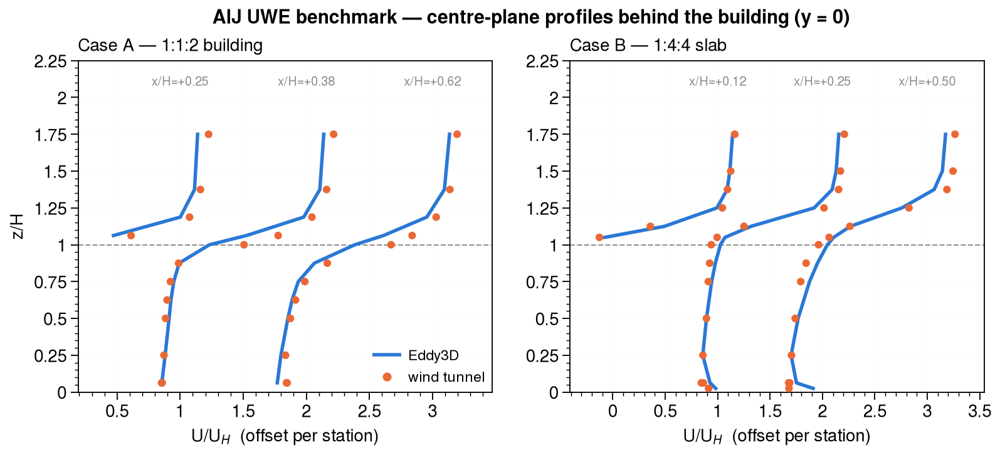

# CFD-Test-Cases-Architectural-Institute-of-Japan-AIJ

Wind-tunnel reference data from the **AIJ UWE** (Urban Wind Environment) benchmark, cleaned and
packaged case by case, together with Eddy3D's validation against it.

| Case | Configuration | Measurements | Reference file |
|---|---|---|---|
| A | 1:1:2 building, b = 0.08 m, H = 0.16 m, Re_H ≈ 24,000 | 186 points, U/V/W/k | `Case_A_cleaned/RS-caseA.csv` |
| B | 1:4:4 slab, 0.05 × 0.20 × 0.20 m, Re_H ≈ 72,000 | 224 points, U/V/W/k | `Case_B_cleaned/RS_caseB.csv` |
| C | 3 × 3 block array, centre building at 0D / 1D / 2D | 1080 points, pedestrian height | `CaseC_cleaned/RS_caseC.csv` |
| D | High-rise among blocks | see `CaseD_cleaned/` | `CaseD(Highrise+Blocks).xls` |
| E | Niigata district, 1:250, pre/post high-rise | pedestrian height | `Case E_cleaned/CaseE(Niigata).xls` |

Sources and instrumentation are documented per case in each folder's `readme_case*.md`. The
accompanying papers are included here.

---

## Validation: Eddy3D vs the tunnel

**Status: Cases A and B, OpenFOAM 12 (realizable k-ε).** Cases C–E and the other solvers are not
done yet — see "What is not validated yet" below. Nothing on this page is a claim about them.

Each case is solved through Eddy3D's production case writer (`build-case → run → probe`), not a
hand-built OpenFOAM case, so what is validated is what a user gets. The probe sits at **exactly the
tunnel's own measurement coordinates**, so no interpolation enters the comparison.

### Does the model agree?

Measured against modelled for each quantity, with the 1:1 line and, where the quantity does not
change sign, the factor-of-two band.

| | A — U | A — V | A — W | A — k | B — U | B — V | B — W | B — k |
|---|---|---|---|---|---|---|---|---|
| **R** | +0.955 | +0.961 | +0.708 | +0.480 | +0.959 | +0.910 | +0.929 | +0.399 |
| **FAC2** | 0.817 | 0.349 | 0.398 | 0.667 | 0.701 | 0.281 | 0.536 | 0.562 |
| **FB** | +0.185 | −0.207 | −1.501 | +0.478 | +0.240 | +0.370 | +0.263 | +0.463 |
| **hit rate** | 0.586 | 0.892 | 0.801 | 0.177 | 0.562 | 0.612 | 0.808 | 0.223 |

Normalised by U_H throughout, the benchmark's own convention. Hit rate uses D = 0.25, W = 0.05 U_H.
Reattachment length behind the building: **L_r/H = 1.49** (Case A), **3.27** (Case B).

Reading these honestly:

- **The streamwise field is right** — R ≈ 0.96 in both cases, FAC2 0.82 / 0.70.
- **k is under-predicted in both** (FB ≈ +0.47, R ≈ 0.4), the familiar realizable k-ε behaviour and
  consistent with what Eddy3D already records for AIJ Case H.
- **FAC2 on V and W is low by construction, not by failure.** Those components change sign, so
  factor-of-two agreement is a harsh measure near zero; R and hit rate are the meaningful columns
  there. The flat row of model V ≈ 0 in Case B's panel is the symmetry plane: a RANS solution is
  symmetric, so V ≡ 0 at y = 0, while the tunnel measures small non-zero values.
- **Case A's W FB of −1.50 and its NMSE are artefacts of a near-zero mean** (mean measured W is
  ~0.01 m/s), not a blow-up. Read R = +0.71 instead.

### Where does it agree?

Vertical profiles of U/U_H on the centre plane at the first three measured stations behind the
building, offset per station. The model follows the measured profile closely above roof height and
in the recovering wake; the near-ground deficit immediately behind the building is where the
closure does least well.

### Two things about the data worth knowing

Both were found by scoring the files rather than reading them, and both would quietly corrupt a
comparison:

1. **Cases A and B report the lateral velocity V with opposite sign conventions.** Just outside the
   windward side face the flow must deflect away from the centreline — toward −y on the y < 0 flank.
   Case A measures **V = −2.893 m/s** at (−0.040, −0.050, 0.010) with its edge at y = −0.04; Case B
   measures **V = +3.630 m/s** at (−0.025, −0.110, 0.013) with its edge at y = −0.100. Same flow
   feature, opposite sign, so **Case B's V is positive toward −y**. Scored without correcting for
   this, Case B's V comes out at R = −0.910 against an R = +0.959 streamwise control on the same
   points — an anti-correlation no turbulence closure produces.
2. **Case B's coordinates are millimetres** (`x[mm]`) while its velocities are m/s; Case A's are
   metres. Read as metres, every probe lands 1000× too far out.

Case geometry was taken from each case's own measurement-point drawing (`MP-z_case*.png`), not
inferred from the CSV extents: both buildings are centred on the origin, with points published on
the y ≤ 0 half by the tunnel's symmetry convention.

### Inflow

Fitted to each case's own approach-flow file over z = 0.02 … 2H, rather than assumed:

| Case | u\* (m/s) | z₀ (mm) | U_H measured (m/s) | log-law error |
|---|---|---|---|---|
| A | 0.343 | 0.668 | 4.491 | +2.0 % |
| B | 0.399 | 0.882 | 5.133 | +2.9 % |

### Reproducing the figures

`validation/plot_aij.py` (UltraPlot) builds both figures from the solved studies and the reference
CSVs. The Eddy3D fixtures are `TestAijCaseAContainerE2E` and `TestAijCaseBContainerE2E`.

### What is not validated yet

| | A | B | C | D | E |
|---|---|---|---|---|---|
| OpenFOAM | ✅ | ✅ | — | — | — |
| OpenLB | — | — | — | — | — |
| FluidX3D | — | — | — | — | — |
| ML surrogate | n/a | n/a | — | — | — |

Cases C–E need their geometry built (C is parametric, D ships an STL, E is a Rhino model of a real
district). The ML surrogate predicts **pedestrian-height** wind, which Cases A and B do not measure,
so there is nothing to compare for those two — marked n/a rather than pending.

---

## Licence and attribution

The measurement data belongs to its collectors and distributors, named per case: Takeshi Ishihara
and Kazuki Hibi (Case A), with the dataset edited and distributed by Yoshihide Tominaga, Hideki
Kikumoto and Tsubasa Okaze. Cite the AIJ UWE benchmark and the accompanying papers when using it.
